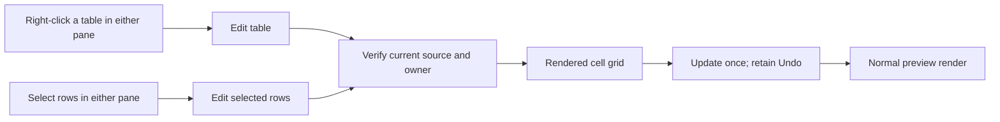

# Customizations

This document tracks custom modifications made to the forked repository that differ from upstream.

## Approach

We use an **overlay customization system** to make it easy to maintain customizations across upstream merges:

- **custom-styles.css** - Style overrides loaded after base styles.css
- **custom-tabs.js** - Tab management functionality loaded after renderer.js
- **custom-performance.js** - Performance optimizations loaded after renderer.js

This approach means after an upstream merge, you only need to ensure these files are:
1. Still present in the repository
2. Still referenced in index.html

> **Scope of the overlay convention (updated).** The overlay is still the
> preferred home for *behavioural* customizations, and the files above are still
> the first place to look. But this fork no longer tracks upstream by wholesale
> merge — upstream changes are now taken as targeted cherry-picks, evaluated
> individually. Keeping `main.js` / `renderer.js` byte-clean against upstream is
> therefore no longer a binding constraint, and the security and performance
> work (see `SECURITY-AUDIT.md` and `PERF-AUDIT.md`) edits those files directly.
> Such edits are kept tightly scoped and commented with their finding ID so they
> can be offered upstream later. Do not read point 2 under "Benefits" below as
> forbidding that.

## Custom Features

### Visual table-cell editing



- In edit mode, both pane menus offer Edit table and Edit selected rows.
- Edit table uses the right-click location, not a selection. Edit selected rows
  requires selected text, not an empty row/table or an image-only range.
  Markdown pipe syntax alone is not cell text. A partial cell selection edits
  that row.
- Markdown row selections may include prose before or after one table. Only
  changed cells are replaced; surrounding text and unselected rows stay unchanged.
- Right-click and Cancel preserve the original selection, including its direction.
- The popup shows rendered cells, never a Markdown textarea or source toggle.
  Closing backticks format code immediately, with the same appearance as loaded
  code. Caret placement, composition and Undo stay inside the cell editor.
- Unchanged source fragments keep authored spans, notes, escapes, entities and
  emoji shortcodes. Editor-owned markers never enter Markdown; authored spans
  are not stripped. New code uses Markdown code spans where they round-trip.
- Capture and native-history markers use names absent from the cell's authored
  source. Live code shares that context. Authored attributes with the old marker
  names remain intact; they are not treated as editor metadata.
- Paste wholly inside Markdown-owned inline code replaces each line break with
  one space immediately, before one native insertion. Blank lines keep their
  extra spaces. For example, `LEFT` and `RIGHT` on separate lines become
  `LEFT RIGHT` in the popup and Markdown, with one cell Undo step.
  Ordinary-cell multiline paste and authored/current-source HTML CODE keep
  their line breaks. Selections crossing code boundaries do not use this policy.
- Inside changed text, keep unchanged source spelling without splitting an
  escape, emoji or Unicode character. Escape boundary punctuation only when
  joining the text would otherwise change its meaning.
- A newly typed multi-backtick span waits for its own closing delimiter.
  An old unmatched delimiter does not block a later valid code span.
  Both opener checks use retained source spelling, not displayed backslashes.
  A literal backslash from an entity or escaped pair does not escape a new
  code opener; a genuinely escaped or encoded backtick stays literal.
  Build delimiter runs from source-eligible ticks, so a literal tick cannot
  hide an adjacent opener. Retained literal body ticks use an aligned parser
  view only for recognition; original DOM text still supplies code and source.
  CODE source output requires captured ownership and an explicit Markdown or
  approved-exception result. Unsupported structures cannot fall through to
  generic HTML. Sourceless DOM comparison does not grant source authority.
  Check CODE ownership before any source fast path: a captured Markdown code
  span, captured HTML CODE, or code generated in that popup. Another captured
  tag or valid whole-cell provenance cannot supply missing CODE ownership.
  New CODE keeps generated ownership within its popup. After Update, an
  approved HTML exception is existing source HTML; reopening preserves that
  exact source like identical authored HTML, without hidden source markers.
- Joining edited text does not unexpectedly turn it into a link or emoji.
  Check whole-cell source ownership, including entity deletions, cell edges and
  joins inside and beside existing formatting. Keep nested literal ranges and
  individual escaped label brackets; protected source atoms are not split.
  Bracket escapes have their own private identity, even beside the same glyph.
- Edited Markdown emphasis and links stay Markdown. Ambiguous adjacent reference
  links become self-contained links, not generated HTML. Unrelated source and
  authored tags keep their original spelling and attributes.
- Full-text replacement inside captured formatting keeps its source ownership
  in one native cell edit. Markdown stays Markdown; authored HTML keeps its tags.
  Native Select All, nested formatting and repeated replacements retain cell Undo.
- A label edit may leave a plain bracket unmatched. Encode only that orphaned
  bracket; keep balanced brackets and captured escapes unchanged.
- Spaces at Markdown bold, emphasis and strike edges use exact numeric entities
  where delimiters require them. Preserve NBSP as `&#160;`, not ordinary space.
  If an edited neighbor makes single-level underscore delimiters invalid, use
  asterisks for that formatting only. Keep valid original underscore spelling.
  If punctuation still prevents a delimiter from opening or closing, encode only the affected
  neighboring literal character. Use the parser's Unicode rules and retain whole
  code points, including supplementary letters. Follow touching owned ancestor
  and child delimiters; shared marker runs and mixed families stay distinct.
  Protected atoms, authored tags and code keep their boundaries.
- Fully wrapped formatting nests keep delimiter families and lengths, preserving
  their nesting order. Repair an invalid underscore join by encoding only the
  adjacent ordinary literal character, not by rewriting nested marker families.
- Adjacent unstyled bold, emphasis or strike content may become one continuous
  span when the separating text is deleted. Code, links and attributed elements
  keep their individual boundaries. Check new joins after normalization too.
- An edit joining different Markdown formatting owners may need opposite
  asterisk/underscore families. Plan the touching sibling group after merging;
  retained nests constrain the plan without changing their spelling or order.
  Strike markers stay fixed. Try only two fixed orientations, each with mapped
  literal repair and full-cell validation, not a combination search.
- Live code keeps retained source atoms before parsing. For example, wrapping
  `literal &#58;star:` keeps the literal `:star:` display, not an emoji.
  Normal code stays backtick Markdown. Only literal emoji-name and
  backslash-before-pipe limits may use a content-preserving `<code>` tag.
  Leaving the cell or moving its caret abandons an unfinished typed delimiter.
- Loading, live code and Update use the same emoji, Markdown and sanitization
  pipeline. New literal text stays literal rather than becoming a link or emoji.
- Tab moves between cells. Enter and Shift+Enter move down and up a column.
  Ctrl+Enter updates; Escape cancels. Cell Undo is separate from document Undo.
  Native cell Undo/Redo cannot consume the Markdown editor's history.
- Bold, italic and underline shortcuts are blocked inside editable popup cells,
  with a clear message before any browser formatting. This is an intentional
  0.11.1 limitation, not an app-wide shortcut change. Existing rich content,
  backtick code, typing, paste and Undo/Redo remain available.
- Scope and keyboard help sit beside the footer buttons in smaller readable
  text. Drag the popup's bottom-right corner to resize it; the grid uses the
  available space while the header and actions stay reachable.
- Update is one document Undo step. It does not save to disk. Cancel is a no-op.
  Later Markdown typing has its own Undo boundary.
- Source, tab, mode, reload and Save changes invalidate an open transaction.
  Duplicate tables use verified source identity, never matching cell text.
- Regular, rectangular Markdown tables support optional outer pipes, alignment,
  empty cells, escaped pipes, Unicode and end-of-file tables.
- Raw HTML tables, nested tables and ragged rows are refused instead of guessed.
  Unsupported cell structures show an error without changing the document.
- Table insertion and Mermaid editing keep their existing separate behavior.

### Offline fenced-code languages

- One local Prism bundle keeps the existing grammars and adds official Prism
  1.30.0 components for Rust, Go, PHP, Ruby, Swift, Kotlin, Dart, R, PowerShell,
  YAML, TOML and Markdown fences, plus PHP's markup-templating dependency.
- `npm run vendor` reproduces the component suffix without rebuilding the
  legacy prefix. Missing sources, version drift and damaged boundaries fail.
- No grammar autodetection, runtime downloads, editor coloring or theme changes.
  Dockerfile is not included.

### Combined feature regression gate

- `npm run test:features` runs updates, grouped toolbar, document editors,
  content-aware scrolling and panel lifecycle before the legacy tab suite.
- `npm test` and Windows CI run that same ordered gate. A broken later suite
  cannot silently skip these feature regressions.
- About also runs with two dirty document editors, retained selection/history,
  shared TOC and zoom through the real isolated production preload.

### Grouped toolbar actions

- Reload and Open editor act on the current document and stay in one group.
- Both are natively disabled without an admitted document, including Welcome
  and last-tab close. TOC stays available. Empty admitted files remain actionable.
- Noninteractive separators divide Reload/Open editor, TOC and the menu.
  The app-wide TOC toggle's pressed state
  follows the same drawer state as the menu, close button, Escape and All Notes.
- TOC visibility applies to every open tab. Toggling it keeps document editors,
  drafts, selection and undo history unchanged.
- The toolbar keeps focus on its TOC button. The menu still focuses the opened
  drawer. Both use `readingSidePanel`, including Welcome and startup choices.
- Action groups wrap within narrow windows; separators stay with TOC and menu.
- `npm run test:toc-toolbar` covers real tab switches, retained drafts, keyboard
  input, process restarts and split/zoom drawer reflow through the production
  preload. Missing cases, failures and timeouts fail the run.
- The command runs in `npm test` and before the legacy test chain in Windows CI.
  Panel lifecycle and theme suites also check the new button's state and colors.

### Document-owned editors

- The toolbar's Open editor button and the menu action only open the current
  document. Repeating either action keeps its draft, selection and undo history.
- An already-open editor command does no render, reset, scroll or focus work.
  Native button focus stays normal. Save and Exit remain separate actions.
- Each tab keeps its own open or closed editor, source selection, scroll offsets,
  history and discard checkpoint. Multiple documents can have editors open.
- Switching tabs restores that document's editor. It never places another
  document's unsaved source in the panel.
- Exit is a separate action in the editor header. Save, discard and cancel keep
  their existing protections. An unresolved Save keeps the editor open.
- A completed Save advances only its owning document's discard checkpoint.
  Newer typing remains unsaved, including when Save completes in the background.
- Disk replacement retires old undo content but keeps that document's open
  intent. Closing its tab retires the session; reopening starts in reading mode.
- Editor sessions stay in memory. They do not change saved reading preferences
  or restore drafts after restart. Welcome has no editable document.
- `npm run test:document-editor` covers real production admission, independent
  drafts, Save, discard, deferred callbacks and stale Exit completions.
- No-document controls are checked after cancellation/refusal/last close and
  against a stale path with no owner. Direct commands cannot bypass disabled UI.
- Failed admission restores captured owner availability, not a nonempty path.
  It never enables actions or reasserts a watcher for an ownerless stale path.

### Content-aware editor scrolling

- Edit mode links the source and preview in both directions.
- Positions follow parsed source occurrences, not matching words, headings alone,
  equal `scrollTop` values or a whole-document percentage.
- Paragraphs, physical prose lines, list items, table rows and code lines provide
  landmarks. Mermaid, images and sandboxed HTML use stable block correspondence.
- A hidden, inert mirror measures the textarea's actual wrapping.
- Small edits keep unchanged whole prefix/suffix spans attached. Matching uses
  exact source slices and distinguishes authored text from the EOF sentinel.
  Binding partitions and UTF-16 boundaries stay unchanged; marker offsets and
  Range positions are rebuilt for the current source and layout.
- Displayed HTML stays unchanged. A separate, inert metadata copy supplies
  source spans only after its complete sanitized structure and text verify.
  Reused nodes receive the new source occurrence's spans.
- Parser-sensitive authored HTML gets one coarse metadata retry. Ambiguous,
  reordered or cross-token annotations are rejected, never matched to later
  repeated words. Opaque multi-root HTML keeps only verified neighboring bounds.
- One source row can describe a tall image; one preview row can span hidden
  source syntax. Each direction keeps that row's leading precise boundary.
  It does not scroll past visible content to manufacture a pixel-for-pixel match.
- Wheel, scrollbar and keyboard input choose the driving pane. Follower scroll
  events cannot take ownership. TOC, search and zoom explicitly use the preview.
- Explicit TOC, document search, internal-link and note navigation cancel the
  saved tab restore before smooth scrolling. Later layout changes cannot replay
  that old reading position. Ordinary tab restoration still follows layout.
- The editor-scroll `transitions` route checks real tab returns, native TOC and
  search-button clicks, completed current-source destinations and actual pane
  resizing. It waits for native scrolling and source geometry, not a fixed delay.
- Scroll-only actions do not change text, focus, selection, undo or dirty state.
  Horizontal scrolling and nested scrollports remain independent.
- New input suspends mapping until the matching preview commits. Layout changes,
  media sizing, zoom, pane sizing and collapse state refresh cached coordinates.
- Input requests a preview after 400 ms without further input. The independent
  undo-history timer stays at 800 ms. Neither is periodic refresh during typing.
- The editor-scroll `mirror` route protects attached span reuse, exact source
  partitions, shifted offsets, Unicode boundaries and fresh resized geometry.
  R1115 restores full replacement while preserving the correctness controls.
  Existing Mermaid/table/general insertion commands share this setting; their
  separately written callbacks are not new ownership guarantees.
- Settled scroll frames binary-search cached coordinates and write only the
  follower's vertical position. They do not parse, scan or re-render the document.
- Physical-line rebuilds walk the paragraph once and measure short text ranges,
  not every remaining line after each break.
- Empty Markdown list items terminate source searches. Bounded actual-Marked
  controls and real reading/edit/full/light-preview cases protect that path.
- Metadata verifies each unchanged tree once. Only tables build physical-row
  descriptors; unused non-table row scans are excluded by work-count controls.
- `npm run test:editor-scroll` uses the production preload and disposable files
  and profile. Performance method and limits are in `docs/PERF-AUDIT.md`.
- Both editor suites run in `npm test`, including the existing Windows CI job.
  Missing required scroll scenarios, assertion failures and timeouts fail the run.

### About and application updates

- Menu: File > About Markaloo, immediately above History, with separators
  above and below About. All Notes and Export keep their earlier order.
- The themed card shows the rainbow feather, product name and Main's running
  version. Status and actions stay below Check for updates.
- Opening or reopening About reads local state, not the network.
- Main owns one state for About and the bottom-right startup notice.
  Explicit checks and downloads coalesce; there is no periodic polling.
- `window-state.json` keeps only `updateAvailability: { schema: 1, version }`.
  Main validates it and uses semantic version ordering. Running the same or
  a newer version removes the notice, including after a manual installation.
- Startup loads only the semantic version validator and comparison functions,
  not the unused range API. The same validation still runs before state is used.
- A later failed or no-update check does not erase a known newer version.
  Failure and unconfirmed remembered availability have separate messages.
- Cached availability never means an installer is ready. Explicit Download
  resolves provider metadata, completes validation, then enables installation.
- Download never installs on ordinary quit. Restart & install uses Main's
  existing document, deletion and shutdown checks. Cancel keeps unsaved work.
- Portable launch failures show a retry action only when safe. An uncertain
  handoff asks for a restart and blocks another installer launch.
- Unsigned macOS uses the fixed official release-download page, not automatic
  download or installation. Platform signature warnings remain unchanged.
- `npm run test:updates` uses controlled providers and disposable profiles.
  No real update, installer, browser, personal document or profile is used.

### Reading zoom

- One app-wide percentage is saved in `readingZoom`, not in document history.
- Buttons, Ctrl/Cmd keyboard shortcuts and Ctrl/Cmd+wheel save the same choice.
- Documents, reader windows and app restarts keep it in normal and split mode.
- Startup restores it before documents render, without rewriting the setting.
- Other same-profile readers follow preference changes without writing them back.
- The range stays 50% to 400%, in 10-point steps. Reset saves 100%.
- Missing or invalid values use 100%. Storage failures warn without disabling zoom.
- Diagram-local zoom and export behavior stay unchanged.
- `npm run test:zoom` covers disposable-profile restarts, controls, modes,
  geometry, invalid values, storage failures and cross-window updates.

### Reading drawers, table headers and update notices

- The left drawer remembers `closed`, `toc` or `notes` in `readingSidePanel`.
- Missing, invalid or unreadable preferences default to TOC without saving a
  choice. A saved Closed or All Notes choice is not replaced.
- The unsaved default waits for the first admitted document, leaving Welcome
  closed. A user choice made on Welcome wins over that pending default.
- Only user toggles, close buttons and Escape save that choice.
- Startup restores it without moving focus. TOC and All Notes remain exclusive.
- `notesVisible` still controls inline annotations, not the All Notes drawer.
- Long tables keep their original header visible until that table ends.
- Horizontal scrolling, column sizing, links and selection use the same table.
- A nested table uses its own header; its enclosing header resumes afterward.
- The renderer caches table boundaries after layout changes. Settled scrolling
  searches that cache and moves one header; it does not scan or measure tables.
- Header movement uses a paused animation, not style writes that would repeatedly
  invalidate the TOC. Print uses the header's natural position.
- File Updated has no expiry. Dismiss, accepted Reload or leaving/closing its
  document clears it. Cancelling a dirty Reload keeps both notice and edits.
- Normal dark Mermaid connectors and sequence messages use 1.5px lines. Light mode,
  authored widths, thick/invisible edges, dashes, labels and markers stay intact.
- `npm run test:reading` covers real process restarts, actual watched-file updates,
  table scroll boundaries and dark/light Mermaid rendering.

### Dark Mermaid borders and lifelines

- Ordinary 1px borders become 1.5px. Default 2px borders and lifelines stay 2px.
  Existing stronger border strokes keep their width.
- Normal arrows and non-arrowed connections use 1.5px. This includes shared
  flowchart/class/state/ER/requirement/block edges, sequence messages and C4,
  architecture, journey, timeline, tree, event-model, Ishikawa, Wardley and
  railroad links. Git branch guides use 1.5px; bold commit connections keep
  their intended width. Mindmap depth widths and data-sized links stay intact.
- Faint neutral borders use muted `#74818f`. Semantic and status colors stay intact.
- Coverage includes shape outlines, compartments and containers in flowcharts,
  block, class, ER, state, requirement and kanban diagrams.
- Sequence coverage includes mirrored participants, actor variants, lifelines,
  notes, activations and loop labels/borders.
- Other border types include C4, Gantt tasks, journey sections/tasks, Git labels,
  pie outlines, architecture groups, packets, treemaps, tree highlights,
  event-model boxes, Ishikawa labels, Wardley nodes and Cynefin regions/items.
  Railroad and EBNF share the same border handling.
- C4 container colors stay authored: Mermaid stores default and authored colors
  in the same SVG attributes, so those borders widen without being recolored.
- Authored theme, border, stroke, color and handdrawn settings keep ownership.
  Ordinary layout, curve and font-size settings do not disable the correction.
- Native size-limit warnings stay visible if optional styling metadata fails.
  A warning is logged, and valid neighboring diagrams still render.
- The pinned Mermaid legacy state renderer is unavailable. State-v2 and the
  unified class renderer have native-render coverage; this does not repair old renderers.
- Inline/class styles, stronger strokes and invisible strokes stay intact.
  Fill-only timeline/mindmap shapes and chart data gain no invented borders.
- Border and connector styling runs once on newly rendered dark SVGs. Light mode and cache hits do
  no extra work. The same SVG styling follows preview, popout and export.
- Marker-free source uses the actual native render type and has no authored
  configuration. Frontmatter/directives or a missing type use the public parser.
  These checks follow pinned Mermaid 11.17 syntax; body styles still keep ownership.
- Styling adds render work, not scrolling work. The earlier 2px/3px treatment's
  bounded matched fixture showed no render/cadence regression; those measurements
  are not a fresh benchmark of the current widths. Configured-source costs were
  not separately measured. Method and numbers are in `docs/PERF-AUDIT.md`.

### File-extension policies

`src/file-helpers-core.js` owns the Markdown/Mermaid extension groups used by
both processes. Main reuses them for dialog filters, trusted drop and CLI
selection; those consumers must not maintain independent copies of the groups.
This does not make every admission surface interchangeable: native Open keeps
All Files and arbitrary selected documents, trusted drop excludes `.ow`, CLI
retains `.ow`, and resolved local links retain their narrower legacy in-app
allowlist after realpath/executable checks. OS associations intentionally list
only the selected registered formats in `package.json`.

Upstream `6089305`'s Mermaid paragraph-wrapper cleanup remains deferred.
Markaloo preserves the full/light render paths' existing paragraph/patch shape;
raw-HTML iframe placeholders already unwrap paragraphs separately. No current
required spacing failure was established, and this is not part of the completed
Mermaid label-sizing/zoom fix. HTML export and persistent refresh blinking
remain deferred; the existing D2/tscircuit/CommonMark/per-block HTML zoom
rejections are unchanged.

### 1. Compact Header (custom-styles.css)
- Reduced header padding from `12px 20px` to `6px 16px`
- Logo reduced from 32px to 24px height
- Button padding reduced from 8px 16px to 3px 8px
- Tighter spacing (gap reduced from 12px to 8px)
- Makes the header more compact while remaining usable

### 2. Enhanced Scrollbar (custom-styles.css)
- Wider scrollbar (16px instead of 12px)
- Always visible with transparent track
- Easier to grab and use for scrolling large documents
- Custom dark mode styling

### 3. Tab System (custom-tabs.js + custom-styles.css)
- Multiple files can be opened in tabs
- Each tab shows filename and can be closed individually
- Active tab is clearly distinguished with accent color border
- Unsaved changes indicator (dot) on tabs
- Tabs persist across app restarts (saved to localStorage)
- Switching tabs preserves scroll position
- Shows file info bar when only 1 file open, tabs when 2+ files

#### 3a. Tab state synchronisation (fixes "refreshing one tab reverts another")

Each tab caches its own `content`, and `switchToTab()` repaints from that cache.
Upstream's reload/save paths only update renderer.js's module-level
`originalMarkdown`, so a refreshed or saved document never reached the tab cache
and the next tab switch silently repainted the pre-refresh copy.

`custom-tabs.js` now keeps the cache authoritative:

- **`file-reload-result` is intercepted** (renderer's own handler is captured and
  delegated to) so the fresh content is written into the tab, the scroll
  position is preserved across the repaint, and the repaint is skipped entirely
  if the user switched tabs while the disk read was in flight.
- **`save-markdown-result` is mirrored** into the tab identified by `data.path`
  (not the currently active tab - the write is async and the user may have
  switched away).
- **Switching to a tab re-reads the file** when its `mtime` changed, so a
  background tab is never shown stale. Tabs with unsaved edits are skipped.

- **Dirty state is structural**: the tab's cached `content` versus its
  `originalContent`, compared with line endings normalised. Reading renderer's
  `#unsavedIndicator` was tried first and is *not* safe - the element keeps its
  inline style after exiting edit mode, so dirty state bled between tabs.
  `renderer.js` exports `window.setUnsavedState()` so the per-tab value is
  restored into renderer's global on every switch.
- **Text that has been through the editor is never compared raw against text
  from disk.** A `<textarea>` normalises CRLF/CR to LF on assignment (HTML
  spec: the API value is the newline-normalised raw value). Since `switchToTab`
  writes `tab.content` into the editor and `snapshotActiveTab` reads it back
  out, an unmodified Windows-line-ending file otherwise came back 2 bytes per
  line shorter and read as edited with zero keystrokes - showing a phantom
  unsaved dot, pausing its file watcher, prompting on close, and converting the
  file to LF on the next save. `sameDocument()` normalises both sides, and the
  snapshot keeps the cached copy when the only difference is that
  normalisation.
- **Scroll position survives a refresh** via a heading anchor ("Nth heading with
  this text, plus a pixel delta") rather than a raw pixel offset, because a
  refresh usually changed the content above the viewport too. A `ResizeObserver`
  re-applies it while diagrams/images settle, cancelled on user input.
- **`getScroller()`** picks `.content-wrapper` in normal view and `#viewer` in
  split/edit view, matching the CSS.

**Disk-version policy (F22, 2026-10-01).** Main, renderer and the tab overlay
compare device, inode, size and `mtimeMs` when checking a file version;
they carry but do not compare `ctimeMs`. Windows can advance ctime after a
file is selected without changing its bytes, causing false Save conflicts
and rejected tab switches. This is an explicit maintainer trade-off, not a
claim that every same-size external change is detected: a different writer
can change bytes without changing the file's identity or size, then restore
its old mtime. In that case the version tuple alone cannot distinguish the
external edit, and a later Save may overwrite it. Deletion, path identity
and ordinary size/mtime mismatch protections remain separate. The stronger
raw-byte witness design is tracked after wave 2 as `ctime-byte-witness` in
`docs/PLANNED-WORK.md`; do not silently restore a strict ctime comparison
without resolving the original false conflicts and measuring the result.

**Clean-tab refresh read boundary (SEC-08, 2026-10-07, unintegrated).** The
changed-disk content read now crosses an owner-bound main-process IPC rather
than reading content in the renderer. Main retains a case-preserving physical
target, pins the read to an opened descriptor and checks both pathname
identities before replying. The lowercased Windows owner key is not an I/O
pathname. Ordinary inode replacement and in-place changes can retry within
the existing stable-read bound, but only while the owner/target remain
authorized. An unchanged clean tab still returns synchronously without a new
snapshot IPC. The renderer rechecks live edits, mutation revision, ownership
and switch currentness before its separate disk-adoption attestation, so a
held read cannot bless a superseded tab's new cache.

This is a preparatory boundary, not completed Node isolation: renderer owner
registration and restored paths remain provisional. Preserve the fail-closed
case-only-rename limitation rather than folding physical pathnames; explicit
reload recovery is source-traced but not runtime-proven. The real-main
replacement regression distinguishes the old descriptor from the replacement
inode and requires replacement-only bytes plus descriptor cleanup. On Windows
the controlled move-aside/install fixture exercises that boundary without
claiming OS-level atomicity. R714-R718 individually protect this slice;
broader Wave 2 and release gates remain separate.

**Document control bridge (2026-10-13, unintegrated).** Registration,
selection/watcher control, quarantine, deletion-state queries and retirement
use fixed validated production preload methods, not renderer raw IPC. Keep the
clean select-before-resume and dirty pause-before-select order and the
synchronous query/retirement boundaries. Ordinary selection may have no disk
baseline; an unavailable disk query may have no physical key. A retirement
refusal with unknown state carries `null`, not a false clean result, and
mutable delivery tokens remain evidence rather than close authority.
The actual deleted-file close still warns before retiring its owner.
R753-R755 and affected shared guards are exact PROVEN; this remains a
preparatory port migration, not completed renderer path authority/isolation.

**Production preload consumers (2026-10-12, unintegrated).** Main windows
always load `main-preload.js`; marked unpackaged test preloads augment rather
than replace it. Clean-tab snapshots and one-use multi-select extras use fixed,
validated methods. Dialog extras carry an opaque main-issued grant, never an
arbitrary read path; main retains sender/session/batch authorization and its
post-read recheck. Response copying validates the existing version tuple
without changing its comparison policy. The unchanged tab path remains
synchronous and makes no snapshot IPC. These are consumer migrations, not a
claim that main-window Node access, provisional registration or restore
authority are already removed.

**Browser crypto and byte counting (2026-10-12, unintegrated).** Session IDs
and tab disk attestation use native browser crypto and exact UTF-8 encoding.
Diagnostic byte counts share a pure browser/CommonJS helper instead of Node
Buffer. Surrogate parity and complete Unicode adoption are protected without
introducing IPC or work on the default diagnostic-disabled path. Main
authorization/adoption semantics are unchanged; remaining isolation and final
responsiveness gates are separate.

**Disk-adoption capability ports (2026-10-12, unintegrated).** Preparation,
commit, completion and abandonment use four fixed validated preload methods,
with the original async/sync ordering and main checks unchanged. Distinct
nullable/current/proposed owners, historical-deletion resolution, disk version,
nonce/digest and completion's unresolved-evidence signal survive the boundary.
The bridge adds no read or IPC; remaining authority/consumer transitions and
final responsiveness acceptance stay open.

**Protected reload confirmation (0.8.1).**

- The `Reload document?` dialog uses the app's light/dark theme, typography
  and buttons. It names the document without treating its name as HTML.
- The reason distinguishes an unavailable file returning, a location opening
  a different file, and a separate earlier copy that remains protected.
  It does not imply that a clean document has unsaved edits.
- Cancel is focused first. Escape, close and backdrop clicks cancel.
  Keyboard focus stays in the dialog and returns to a visible app control.
- Main retains the exact approved-read transaction. The fixed asynchronous
  reply carries only its nonce, page identity and the user's choice.
  Main repeats the original owner, evidence, sibling, path and version checks.
  A reply cannot extend the original approval deadline.
- Changed documents, selection, reload requests, page navigation and owner
  closure invalidate the question. Cancellation preserves deletion evidence.
- Ordinary reloads keep their existing commit transport. Genuine unsaved-edit
  confirmation remains separate. Historical retirement has its own themed
  question and defaults to keeping the earlier protection.
- `npm run test:reload-dialog` exercises the production preload with disposable
  profiles/files. The revert harness owns the exact sensitivity records.

**App-owned message and confirmation dialogs (0.8.1).**

- Shared themed cards cover browser messages and document decisions.
- Main uses its own isolated themed host for large-document, external-file,
  shutdown and terminal safety questions.
- Async answers repeat the relevant state and authority checks; cancellation
  never grants permission. Native pickers and narrowly bounded failed-host
  emergency messages stay native.
- Child popouts use the selected app palette and bundled font.
- [Dialog inventory and exclusions](DIALOGS.md) lists every migrated family,
  retained themed editor, lifecycle rule and regression command.

**Right-click menu fit (2026-10-12, unintegrated).** Menus fit their untransformed
layout size with normal viewport margins, scroll vertically when needed and
wrap at extremely narrow widths. Only scrolling inside a menu avoids the
existing document-scroll dismissal; ordinary document scrolling still closes
it, and reopening starts at the first command. The existing flat command set,
actual handlers and unrelated nested toolbar menus are preserved.

**Narrow-window menus (2026-10-12, unintegrated).** The upstream viewport-cap
fix is adapted without its nested-flyout clipping. Wide menus preserve their
original minimum widths and cap content expansion; compact menus put nested
File/View/Theme panels in normal flow under a bounded scrolling root.
The supported lower bound is the OS-achievable window, not the compact-header
threshold. Labels and controls wrap at that bound; returning wide restores
left-opening flyouts. Document zoom does not resize the toolbar. Preserve the
wide frozen declarations as well as compact reachability when picking later
upstream menu changes; R741/R742 protect the two layouts.

**"File Updated" prompt behaviour.** The bottom-left toast
(`#fileUpdateToast`) is only appropriate for the tab the user is actually
looking at, because that is the only one we deliberately do *not* reload
automatically - yanking the document out from under a reader would be worse
than asking:

- A background tab is reloaded silently on switch and confirmed with the
  passive "File reloaded successfully" notification instead of an actionable
  prompt.
- Switching tabs dismisses any pending prompt. It is bound to renderer's
  `currentFilePath`, so after a switch its Reload button would act on a
  different document than the one it was raised for.
- The prompt's Reload button is rebound to a guarded handler. Upstream wires it
  as `onclick="reloadCurrentFile()"`, which - unlike the toolbar refresh button
  - reloads with no unsaved-changes confirmation. Assigning `.onclick` replaces
  the inline attribute rather than adding a second listener, so renderer's own
  call sites are untouched and the user is never asked to confirm twice.
- After any foreground reload the overlay calls `window.setUnsavedState(false)`.
  Renderer only clears its own flag when reloading *in edit mode*, so a
  view-mode reload otherwise left a phantom dirty state that suppressed all
  later update prompts.

**The foreground reload completion is scoped to the tab and render that started
it.** `renderMarkdown()` is genuinely async - mermaid/D2 diagrams take seconds -
and renderer's `file-reload-result` handler awaits it. Anything the overlay does
after that `await` therefore runs against whatever document is active *then*,
not the one that was reloaded. Two real failures came out of this:

- Typing during the render, then having the completion call
  `setUnsavedState(false)`, marks the new edits saved; the next refresh
  discards them with no warning. The completion now compares the live document
  against a baseline and, if they differ, writes the live text back and keeps
  the tab dirty instead of clearing the flag. The baseline is *sampled through
  the same expression as the live read*, immediately after `delegateReload()`
  returns - not taken from `data.content`. Renderer runs synchronously up to
  its `await renderMarkdown(...)`, so by then it has already assigned
  `markdownEditor.value = data.content`, and a `<textarea>` normalises CRLF to
  LF on assignment. Comparing against the raw `data.content` reported every
  Windows-line-ending file as edited on every reload with no user input at all,
  permanently dirtying the tab (which pauses its watcher and prompts on close)
  and rewriting the file to LF on the next save.
- Switching to a dirty tab during the render made the completion clear *that*
  tab's flag and scroll it to the old tab's anchor - and, once the check above
  existed, write the new tab's text into the old tab's cache. A
  `renderGeneration` counter plus the originating tab id are captured before
  `delegateReload()`; if either has moved on, the completion is discarded
  outright. (`switchToTab` was already generation-guarded; the reload path was
  not.)

**Overlay disk reads go through `file-helpers.js`.** Three overlay paths read
files directly rather than over IPC - auto-refresh on tab switch, session
restore, and multi-file open. `main.js` does not hand the renderer raw file
bytes: `readMarkdownFile()` strips the BOM *and* wraps `.mmd`/`.mermaid`/`.ow`
content in a fenced code block. A plain `fs.readFileSync` in the overlay
therefore produced different text than the same file opened normally, silently
dropping the fence so the diagram source rendered as plain text. The overlay now
`require()`s the same helper instead of re-implementing the rules, so the two
paths cannot drift when upstream changes them.

Two small upstream edits were unavoidable:

- `main.js` gained an `ipcMain.on("set-active-file")` handler. `custom-tabs.js`
  had always sent this on every tab switch but **nothing handled it**, so the
  file watcher stayed pinned to whichever file was opened first. It honours a
  `watchingPaused` flag so a tab switch cannot re-arm a watcher the renderer
  deliberately paused during an edit.
- **Closing the last tab disarms the watcher** (`stop-file-watching`) and clears
  `currentFilePath`. Otherwise the watcher stayed armed on the file just closed
  and an external change raised a "reload?" prompt over the welcome screen, for
  a document with no tab.
- `renderer.js` exports `window.i18n`, `window.setUnsavedState` and
  `window.dismissFileUpdateNotification`. The last one is already an implicit
  global today, but the overlay must not rely on that: renderer's
  `fileUpdateNotificationShown` flag is module-private, so a DOM-only dismissal
  would leave it stuck `true` and silently swallow the next external-change
  notification until the real dismissal resets it.

Regression coverage: `npm run test:tabs` (see below).

### 4. Fixed EPIPE Error (main.js)
- Replaced `console.log/error` with safe `log()` function in file operations
- Prevents crashes when app is launched by double-clicking .md files (no terminal attached)
- Fixes "write EPIPE" errors in stopFileWatching and other functions

### 5. PDF Export Optimizations (custom-styles.css)
- Hides header, tabs, and file info bar in PDF exports
- Forces light mode colors for PDF (white background, dark text)
- Ensures PDFs are printer-friendly regardless of app theme
- Removes editor view from exports if in split mode

### 6. Performance Optimizations (custom-performance.js + main.js + package.json)

**Problem**: ~10% CPU usage when app is visible but unfocused.

**Root cause**: Two compounding issues:
1. Electron 27 overrides a private macOS API (`_cornerMask`) forcing macOS WindowServer to recalculate window shadows every display frame
2. Upstream has an unthrottled global `mousemove` listener firing on every pixel of movement

**Solutions**:
- **Electron upgraded to ^43.2.0** — the `_cornerMask` bug is fixed from ^37 onward (merged in [electron/electron#48376](https://github.com/electron/electron/pull/48376)); ^41.7.1 or later is additionally required to clear the security advisories affecting every earlier line
- **`backgroundThrottling: true`** in `main.js` BrowserWindow options — lets Electron reduce activity when window is in background
- **`custom-performance.js`** — throttles mousemove to 80ms intervals, drops events entirely when window is unfocused, dismisses floating panels (recent files, toasts) on blur
- **Electron upgrade is protected** via `scripts/post-upstream-merge.sh` which re-pins to `^43.2.0` after any upstream merge

**Important**: If an upstream merge resets `package.json` electron to `^27`, run `./scripts/post-upstream-merge.sh` to restore `^43.2.0`. Electron 43+ requires Node >= 22.12, which is pinned in `.nvmrc` and enforced by `engine-strict`, so the Electron pin and the Node pin must be raised together.

### 7. Mermaid label measurement and compact wrapping (renderer.js + mermaid-config.js)

Mermaid's HTML-label measurements use viewport coordinates, but its SVG layout
uses document coordinates. Markaloo's reader zoom previously mixed those units:
adding diagrams and manually reloading at 150% could produce clipped labels
that stayed clipped after returning to 100%, while reopening the same document
fresh rendered correctly.

All three drawing paths now measure in a hidden, inert staging container
outside the zoomed reader. Each staged diagram retains its logical width and
typography, including the width-dependent Gantt layout. The live diagram stays
in place until the new SVG is ready; cancelling zoom on the live reader instead
was rejected because it moved the reading position during theme changes.
Adoption checks the caller's generation and the original node's source and
identity. Moving actual child nodes preserves Mermaid's native bindings; stale
output is neither adopted nor cached, and the staging container is always
removed, including after a rejected batch.

- Flowchart labels can grow to 260px before automatic wrapping. Short labels
  stay small; the same budget applies to rectangles and decisions.
- A roomy rectangle with a long sentence uses fewer lines. A decision may grow
  wider than before. Explicit breaks and author configuration still win.
- Mermaid sizes shapes and routes arrows together. No SVG nodes are stretched
  after rendering.
- In a narrow TOC or split view, tables first wrap short columns and reduce
  compact-cell padding. When six columns cannot fit into a split pane, the
  table remains horizontally scrollable rather than breaking every header
  into individual letters. Dragging or resetting the split bar updates the
  table after the pane width changes.
- Long links and inline code can wrap inside table cells without changing
  preformatted blocks.

The targeted suite covers the real add/reload/zoom-reset journey, theme and
insertion paths, full-label geometry, compact decisions, bindings, stale
adoption, scrolling in normal/split view and width-dependent layouts. Its
roomy 100% and constrained/zoomed captures must be opened when checking visual
changes; merely writing PNGs is not visual verification.

### 8. Left table of contents and current section (renderer.js + styles.css)

- The TOC opens on the left. Opening it closes All Notes; opening All Notes closes the TOC.
- The drawer reserves document space, capped at 40% of the window width. Its transform animates; the document margin does not.
- Opening or closing the drawer preserves the reading position through the existing zoom-anchor helper. Native scroll anchoring is paused for that correction.
- The current section is the last visible heading at the 20px reading line. Before the first heading, the first heading is current; at the bottom of an overflowing document, the last heading is current.
- Tracking includes every supported heading level, H1-H6, including skipped levels and long nested sections. Each row keeps its heading's indentation and direct click target.
- Native buttons support keyboard navigation. The named navigation region, expanded state, `aria-current="location"` and hidden-panel `inert` state expose the same state to assistive tools.
- Scrolling updates only the old and new active rows. It never focuses a row or scrolls the document; it reveals the active row inside the TOC when needed.
- Passive, frame-coalesced listeners follow the real scroll owner in normal and split view. Binary search uses cached heading positions; settled scrolling does not measure every heading or rebuild the list.
- Content changes, collapse/expand, images, Mermaid adoption, font loading, zoom and resizing invalidate the cache. Closed drawers disconnect their observers and cancel pending tracking work.
- TOC clicks retain ancestor expansion and document navigation. Switching tabs, reloading, or rendering a document without headings replaces stale outline state.
- Print hides the drawer and removes its reserved space.
- Continuous authored CSS animations that move headings without a DOM or observed size change are not tracked continuously. There is no permanent frame loop or per-heading observer.
- Focused coverage: `npm run test:toc`. Measured scrolling costs and environment limits are recorded in `PERF-AUDIT.md`.

## How to Maintain After Upstream Merge

**After every upstream merge, run the post-merge script:**

```bash
./scripts/post-upstream-merge.sh
```

This script automatically:
- Re-pins Electron to `^43.2.0` (overwriting any upstream downgrade)
- Checks all custom file references in `index.html`
- Checks all custom files in `package.json` build list
- Verifies `backgroundThrottling: true` in `main.js`
- Runs `npm install` with the correct Electron version

### Manual Checklist (if not using the script)

### 1. Check Files Exist
```bash
ls custom-styles.css custom-tabs.js custom-performance.js scripts/post-upstream-merge.sh
```

### 2. Verify index.html References
Ensure index.html contains:
```html
<head>
  ...
  <link rel="stylesheet" href="styles.css">
  <link rel="stylesheet" href="custom-styles.css">  <!-- This line -->
</head>
<body>
  ...
  <script src="renderer.js"></script>
  <script src="custom-tabs.js"></script>  <!-- This line -->
  <script src="custom-performance.js"></script>  <!-- This line -->
</body>
```

### 3. Test Functionality
```bash
npm run test:tabs   # automated tab regression suite
npm start           # manual smoke test
```

`npm run test:tabs` runs `test-tab-refresh.js`, which boots the real `main.js`
in Electron and drives the renderer through the multi-tab scenarios that the
overlay is responsible for (refresh does not revert other tabs, background tabs
auto-reload from disk, unsaved edits are never clobbered, refresh keeps the
reader at the same heading, the "File Updated" prompt appears only for the tab
being actively viewed). It needs no test framework - only the Electron
that already ships as a devDependency. **Run it after every upstream merge**:
it is the fastest way to detect that upstream changed its reload, save or
watcher contract.

Two things to know when editing the harness:

- A native `confirm()` / `alert()` blocks `executeJavaScript` **forever**, so a
  bug turns into a silent hang. There is a 180s watchdog that fails loudly and
  prints partial results. If it fires, look for a modal dialog.
- `closeTab()` re-derives dirtiness from live renderer state via
  `snapshotActiveTab()`, so teardown must leave `window.originalMarkdown` in
  agreement with the active tab or it will raise a real confirm dialog.

When adding a regression check, prove it is meaningful: revert the fix it
covers, confirm the check fails, then restore. Every assertion in the suite has
been validated this way.

Verify manually:
- [ ] Scrollbar is visible and wide
- [ ] Header is compact
- [ ] Opening multiple files creates tabs
- [ ] Tabs can be switched and closed
- [ ] Tabs persist after restart
- [ ] Refreshing one tab does not revert another
- [ ] The "File Updated" prompt appears for the tab you are looking at, but a
      background tab reloads silently with a passive notification
- [ ] CPU usage is low when app is idle (~0-1% instead of ~10%)
- [ ] PDF exports don't include header/tabs and use light colors

### 4. If Something Breaks

Check browser console (F12) for errors. Common issues:

**Tabs not working:**
- Check if `tabsContainer` element exists in index.html
- Verify custom-tabs.js loads after renderer.js
- Check console for `[CustomTabs]` log messages

**Styles not applying:**
- Verify custom-styles.css loads after styles.css
- Use `!important` if upstream styles override (already done)
- Check for CSS syntax errors

**File opening in wrong way:**
- The custom-tabs.js intercepts `file-opened` IPC events
- If renderer.js changes its file handling, may need adjustment

## Modifying Customizations

### To Change Header Size
Edit `custom-styles.css`, find:
```css
.header {
  padding: 6px 16px !important;
}
```

### To Change Scrollbar Width
Edit `custom-styles.css`, find:
```css
::-webkit-scrollbar {
  width: 16px !important;
}
```

### To Modify Tab Behavior
Edit `custom-tabs.js` - all tab logic is in this file.
Key functions:
- `createTab()` - Creates a new tab
- `switchToTab()` - Switches active tab
- `closeTab()` - Closes a tab
- `renderTabs()` - Updates tab UI

## Version History

- **2026-02-07**: Initial customization overlay system created
  - Extracted tab functionality from original fork
  - Created modular overlay approach for easier maintenance
  - Preserved scrollbar and header customizations

## Benefits of This Approach

1. **Easy to Maintain**: After upstream merge, just verify 2 files + 2 lines in index.html
2. **Non-Invasive**: Doesn't modify upstream files directly
3. **Clear Separation**: Custom code is isolated and documented
4. **Easy to Disable**: Remove 2 lines from index.html to disable
5. **Easy to Extend**: Add more custom-*.js or custom-*.css files as needed

## Future Customizations

When adding new customizations:

1. Create new `custom-<feature>.css` or `custom-<feature>.js` file
2. Add reference to index.html
3. Document here in CUSTOMIZATIONS.md
4. Use descriptive console.log prefixes like `[CustomFeature]`
5. Wrap JS in IIFE to avoid global scope pollution
