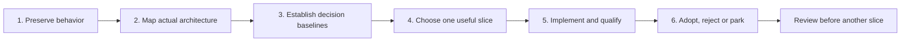

# Performance architecture plan

- Goal: make content readable and scrolling/typing effective sooner, while
  keeping complete, correct output.
- Preserve functionality and safety, not every current internal implementation.
  Improve a component or replace a subsystem when evidence supports it.
- Do not start a whole-app language/framework rewrite. Do not choose a language,
  worker, package, cache or virtualization strategy before comparing the options.
- Work through one deliverable at a time. This assignment covers the plan and
  source-based Step 1 only. Steps 2-6 have not started.
- Step 1 inventory and independent Sol/Luna review are complete. Coordinator
  handoff comes next; no runtime qualification or Step 2 execution is claimed.

## Sequence and handoffs

| Step | Concrete deliverable | Prerequisite and exit check | Not part of this step |
|---|---|---|---|
| **1. Preservation contracts** | The inventory below: released behavior, a representative regression scenario, source/test references and known gaps. | Identify the released source. Every group has a supported contract or an explicit uncertainty. Independent Sol/Luna review, then coordinator handoff. | Product/test changes, runtime collection, architecture selection or performance claims. |
| **2. Actual architecture map** | One open/edit/render/export flow diagram and ownership notes. Identify state/result owners, source revisions, invalidation/cancellation, compute versus DOM/layout work, and each readiness signal. Separate source facts from hypotheses. | Accepted Step 1. Trace each boundary and suspension point needed for the next decision; explain what can still be unfinished when a promise resolves. | Replacement design, a full profiling campaign or assuming a large file is itself the bottleneck. |
| **3. Decision baselines** | Agreed user-visible outcomes and workloads; reusable qualified evidence; a short list of decision-critical missing observations. | Accepted map. Freeze workloads, start/end conditions, comparison method, acceptance criteria and stop rules before experiments. Use existing qualified tooling where possible. | Arbitrary new SLOs, new benchmark infrastructure by default, or collecting everything that could be measured. |
| **4. Options, return and one slice** | Compare improving the current component with selective replacement; recommend **one** next slice. Weigh the expected user-visible benefit against functionality/security risk, validation/maintenance complexity, CPU/memory cost and likely time-to-value without invented estimates. | Baselines support the comparison. Bring significant architecture, behavior or scope tradeoffs to the user; record the selected slice and its bounds. | Predetermined technology, whole-app rewrite, invented hours/dollars/speedups, or several combined experiments. |
| **5. Implement and qualify one change** | Isolated Sol/high implementation; relevant durable tests and individually sensitive revert proofs; independent Sol/Luna feedback; fair comparison with the released baseline. | Selected, authorized slice and frozen method. Demonstrate the intended visible effect and complete output. Protect ownership, current-source results, errors and affected contracts. Keep slow/failing samples and setup failures. | Retry-until-green, sample filtering, unrelated fixes/dependencies, or treating an earlier callback as improvement. |
| **6. Adoption and next iteration** | Adopt, reject or park with demonstrated benefit, costs and limits. Keep the released fallback during qualification; remove the losing shipping path after the decision. | Qualification and reviews complete. Useful improvement must be demonstrated; otherwise reject/park. Coordinator reviews the outcome before another slice is chosen. | Permanent two-renderer complexity by default, automatic next-slice execution, integration or publication without separate authorization. |

- Coordinator reviews sequential handoffs; this is not a user-approval prompt
  for every mechanical action. Ask the user about real design/scope/behavior
  choices, unresolved preservation expectations and meaningful tradeoffs.
- Roles for this continuation: latest Astra for design/investigation; latest
  Sol/high for documentation and implementation; fresh independent Sol/high
  and Luna/high review the actual deliverable. Correct material findings and
  review the correction before handing off.
- Preserve existing performance gates in
  [PLANNED-WORK](PLANNED-WORK.md#performance-acceptance-gates).
  Step 3 adds decision-specific criteria; it does not quietly replace them.
- No app, tests, builds, benchmarks, samplers, profiling or dependency commands
  run for this documentation unit. No real profiles/logs, product/harness edits,
  PoC imports, pushes, PRs, tags, integration or publication.
- Dependency maintenance remains separate and on hold through October 28, 2026,
  subject to approved feed availability. Do not bundle it into architecture work.

## Step 1: preservation inventory

### Source and evidence boundary

- Released reference: **v0.10.0**, source
  `f5d380786fb895bf783e263f79aea6316f303ad1`, tree
  `45eb10efd93e6dee7dc583a80488bad1e6cdda5a`.
- Working baseline: canonical main
  `90111cfa30f35a39515072b3258265d8f32528ee`.
  Only the release-completion register differs from the tag; runtime source,
  tests, scripts, dependencies and shipped libraries match.
- Source/test line references below describe that released baseline, not an
  unadopted experiment. Executable code wins over stale comments or old audit
  line numbers. References identify representative coverage, not every assertion.
- **Source** means inspected implementation. **Test** means an existing
  assertion was inspected, not run here. **Release** means retained v0.10.0
  qualification, not a new execution or a universal guarantee.
- Retained release receipt: session `54f84d1f-cf48-44eb-96f1-f67e066f2402`,
  `files/release-0100-final-result.json`, SHA256
  `1298b716d24380f5829057cdc9597681c2ecbe16257b0a571f03e0cbacb5ec96`.
  Its source/tag/tree and file hash were checked read-only.
  The repository summary is [release-0.10.0](PLANNED-WORK.md#current-workset).
- Release evidence includes affected source gates, strict built-ASAR checks
  without skips, and 48/48 fresh-profile actual Windows package checks through
  the production preload. It is **not** a full `npm test` pass, installed live-upgrade
  check, cross-platform UI certificate or physical-paint/input guarantee.

### Contracts and representative regressions

| ID / behavior and important invariant | Representative user action and regression signal | Source | Existing tests | Evidence / known gap |
|---|---|---|---|---|
| **P1. Admit a document, not just a path.** Welcome/no admission differs from an admitted empty file. Cancel/refusal keeps the prior owner and controls. Large-document admission/switch consent remains scoped; reload is not given another size prompt. Main-issued session restore retains order/selection and reports unavailable entries. | Cancel opening over a dirty editor, then admit an empty file. Failure: the draft disappears, stale paths enable Reload/Edit, or the empty file cannot be edited/reloaded. | [beginFileOpen](../src/renderer.js#L8326-L8440), [switch consent](../src/custom-tabs.js#L2530-L2651), [Main confirmation](../src/main.js#L4439-L4489), [session restore](../src/custom-tabs.js#L3429-L3484). | [empty/refused admission](../test/test-document-editor.js#L148-L221), [session restore and fail-closed cases](../test/test-document-session.js#L181-L267). | Source + Test; release editor checks. Restore assertions are not a new restart run here. No path/content truthiness substitute for ownership. |
| **P2. Tabs, reload and disk changes stay independent.** Each tab keeps its current source and disk baseline; background refresh cannot replace dirty work. Watcher notices and accepted/failed reload results belong to their document. Cancel keeps edits and the actionable notice. | Refresh B, refresh A, return to B; edit A while disk changes; cancel Reload. Failure: B reverts, A's draft is replaced, or A's notice appears over B. | [switch/refresh](../src/custom-tabs.js#L2613-L2688), [owned reload request](../src/renderer.js#L3522-L3598), [Main request identity](../src/main.js#L9215-L9277). | [original two-tab regression](../test/test-tab-refresh.js#L16164-L16215), [actual watcher/dirty reload](../test/test-reading.js#L372-L431). | Source + Test; extensive legacy tab coverage exists but the full suite is not green. Same-size edits with restored mtime remain a known disk-version gap, not a new promise of detection. |
| **P3. Async work needs the right owner and current source.** Document identity, source/mutation revision, navigation intent and render generation are different checks. Preserve existing stale render/highlight/consent rejection and owner-specific overlay cleanup. Current-source ownership is required safety, not a claim that every dialog already enforces it. | Start work, type again or switch tabs, then let the old callback finish. Failure: stale content wins, a consent applies to newer text, an old completion hides the new overlay, or loading stays stuck. | [revision-specific consent](../src/custom-tabs.js#L480-L523), [render dispatcher/full path](../src/renderer.js#L6704-L7000), [overlay ownership](../src/renderer.js#L3465-L3495). | [held stale/current idle callbacks](../test/test-language-highlighting.js#L309-L340), [pending editor callbacks](../test/test-document-editor.js#L399-L426), [overlapping render overlays](../test/test-tab-refresh.js#L17941-L18130). | Source + Test; released syntax callback checks. Stale-result rejection is not proof that obsolete CPU work is interruptible. Same-generation edits need revision/source checks, not generation alone. Table-dialog ownership has a source-observed gap in P8. |
| **P4. Editors and drafts belong to documents.** Each editor retains open intent, text, selection, undo/redo, both scroll axes and discard checkpoint. Repeated Edit is a no-op. Close retires the session; reopening starts reading. Draft/history remain in memory, not restored as saved reading preferences. | Edit A and B, switch repeatedly, repeat Edit, discard only A, close/reopen A. Failure: text/history leaks between tabs, focus/selection resets, or discarded/closed work returns. | [private editor state](../src/custom-tabs.js#L392-L451), [capture/exit](../src/renderer.js#L3672-L3838), [persisted layout fields](../src/custom-tabs.js#L3363-L3384). | [independent editors/history/scroll](../test/test-document-editor.js#L228-L458), [disk replacement and retirement](../test/test-document-editor.js#L536-L635). | Source + Test; release editor checks. Privacy contract is no new draft persistence/telemetry, not a claim that saved files, paths or reading anchors contain no document information. |
| **P5. Save, refusal and shutdown protect unsaved work.** Save advances only its owning document's written baseline. Later typing remains dirty; a background result cannot clear another editor. Unresolved Save keeps the editor open. Discard/cancel, disk replacement/deletion, write failure and close/update shutdown keep their existing protections. | Save A, type newer text, switch to B before completion; return and discard A. Failure: newer typing becomes clean, B changes, stale undo returns, or cancellation exits/installs anyway. | [Save-result adoption](../src/custom-tabs.js#L3977-L4031), [serialized writes](../src/main.js#L5109-L5121), [pending Save/Exit](../src/renderer.js#L3738-L3815), [close guards](../src/custom-tabs.js#L3075-L3245). | [held real writes/background completion](../test/test-document-editor.js#L480-L552), [owned dialogs](../test/test-owned-dialogs.js), [update/shutdown controls](../test/test-about-updates.js). | Source + Test; release editor/update checks. Existing Save-alias and hosted shutdown/legacy failures remain separately tracked in PLANNED-WORK; no claim that all races are solved. |
| **P6. Scroll follows the same source occurrence.** Source/preview mapping preserves semantic location, not equal pixels or whole-document percentages. New input suspends stale geometry; layout/media/zoom invalidate it. User input owns the driver; follower events do not. Explicit navigation retires old restoration; ordinary tab/resize restoration still works. Metadata stays separate, inert and verified; it must not alter HTML/SVG/raw text/tables. | Scroll repeated prose, a tall image/diagram or code line in either pane; navigate by TOC/search, then resize. Failure: wrong repeated occurrence, feedback bounce, selection/undo changes, old position replayed, or different parsed HTML. | [verified inert metadata](../src/editor-scroll.js#L318-L452), [input/current-source lifecycle](../src/editor-scroll.js#L800-L886), [preview navigation](../src/renderer.js#L1131-L1136). | [native navigation/actual resize and ordinary restore](../test/test-editor-scroll.js#L299-L437), [input/layout/edits](../test/test-editor-scroll.js#L583-L837), [HTML equivalence/rejection](../test/test-editor-scroll.js#L1015-L1155). | Source + Test; release transitions/layout/input and actual packaged navigation checks. Coarse/ambiguous mapping is explicit, not invented precision. No universal OS-input or zero-pixel-error guarantee. |
| **P7. Parsing and trust boundaries survive.** Full/light paths keep Markdown, BOM/CRLF, emoji, authored HTML and supported local/data images faithful. Sanitize assembled output; sandbox explicit raw-HTML documents. Main owns file admission/writes and trusted external actions; no page Node/general IPC or broader popup capabilities. Rendering libraries remain local. | Open mixed/hostile markup in reading/edit/full/light paths and previews/popups. Failure: altered canonical structure/text, executable host injection, unauthorized file action or unexpected external open/request. | [shared sanitizer](../src/renderer.js#L185-L241), [raw HTML sandbox](../src/renderer.js#L700-L766), [production isolation/navigation guards](../src/main.js#L3289-L3382), [trusted gestures](../src/main-preload.js#L36-L84), [popup-specific bridge](../src/popup-preload.js#L1-L45), [CSP/local libraries](../src/index.html#L31-L68). | [render security](../test/test-render-security.js), [popup security/export controls](../test/test-popup-security.js), [canonical HTML](../test/test-editor-scroll.js#L1034-L1082), [offline sentinel](../test/test-language-highlighting.js#L469-L483). | Source + Test; release syntax/isolation checks are narrower than the whole security suite. Offline libraries do not mean every document causes zero network: CSP permits authored HTTPS images. Preserve intended resource policy, not a blanket network claim. |
| **P8. Rich content stays usable; source edits must target their owner.** Preserve table widths, original headers, horizontal/nested scrolling and popup/export text; Mermaid's valid neighbors, source, authored styling, theme/zoom and popouts; images, H1-H6, collapse, notes and checkbox edits. Reuse must not retain stale presentation or metadata. Correct source targeting is required safety, with table gaps at right. | Insert prose before highlighted code/diagrams; edit one repeated source block; switch theme, collapse and resize a wide table. Failure: wrong block changes, text disappears, duplicate controls, lost handlers or stale SVG/mapping. | [DOM reuse](../src/renderer.js#L6199-L6260), [rich render stages](../src/renderer.js#L6802-L6998), [table behavior](../src/renderer.js#L7238-L7453), [table source lookup](../src/renderer.js#L11624-L11648), [table edit commit](../src/renderer.js#L12601-L12678), [Mermaid edit checks](../src/renderer.js#L12345-L12387). | [patch/source-edit regressions](../test/test-render-patch.js), [tables](../test/test-table-display.js), [Mermaid ambiguity refusal](../test/test-mermaid-render.js#L3249-L3268), [original headers/theme/popouts](../test/test-reading.js#L194-L368), [code reuse](../test/test-language-highlighting.js#L433-L448). | Source + Test; no fresh rich-content run. Table lookup takes the first best score without rejecting ties. Table commit checks mutation permission, but lacks Mermaid's captured render-generation and unique-target checks. Mermaid also checks target presence/current-source uniqueness; that is not a captured document/source-revision guard. Node identity is useful current reuse, not a fixed algorithm requirement. |
| **P9. Syntax coverage, plain fallback and copy remain exact.** Rust, Go, PHP, Ruby, Swift, Kotlin, Dart, R, PowerShell, YAML, TOML and Markdown plus legacy grammars/official aliases. Unknown/unlabelled fences stay plain; inline code/source editor stay plain. Tokens never change copied source. | Open every supported fence/alias, an unknown label and escaped markup; copy Rust, search a token, then make an unrelated edit. Failure: missing grammar, live source tags, changed copy text or unnecessary loss of correct processed blocks. | [official component bundle](../scripts/vendor-prism.js#L7-L55), [selective highlighting](../src/renderer.js#L6694-L6700), [copy buttons](../src/renderer.js#L7690-L7757). | [legacy output/aliases](../test/test-language-highlighting.js#L78-L126), [rendered fences/copy/search/themes](../test/test-language-highlighting.js#L341-L448). | Source + Test + released source/package language checks. Dockerfile and invented aliases are not supported additions. Syntax speed is separate from semantic/copy correctness. |
| **P10. Search uses actual rendered text and current input.** Case-insensitive literal search, terms of at least two characters; Enter/Shift-Enter and next/previous flush pending input. Close cancels pending work and clears marks. Decoration does not alter source text. | Type a different term and immediately navigate; search inside a Prism token; close before debounce fires. Failure: previous-term navigation, changed code text or marks reappearing after close. | [text-node matching and navigation](../src/renderer.js#L5009-L5230). | [token text](../test/test-language-highlighting.js#L378-L390), [legacy intended scenarios](../test/test-search.js). | Source + Test + direct actual packaged search checks in the release receipt. Legacy `test:search` fails before functional assertions and is **not passing coverage**. Matching across separate token/text nodes and inside SVG/Mermaid is not promised by this implementation. |
| **P11. Export is complete output, not viewport readiness.** Preserve supported PDF/table/image/diagram output and Main-owned destinations/actions. Print hides controls/drawers/editor, expands collapsed sections, keeps natural table headers and uses the export theme; restore the reader's current theme/zoom after completion/failure. Pending work, document identity and operation lifetime need their own checks. | Export a long mixed document with a collapsed section from dark split view, including off-screen content; change theme or navigate during preparation. Failure: omitted content, printed controls, wrong-document output or leaked export appearance. | [PDF lifetime/write](../src/main.js#L5008-L5091), [theme holds](../src/renderer.js#L3347-L3452), [prepare/result](../src/renderer.js#L3605-L3645), [print CSS](../src/styles.css#L2352-L2394), [print expands sections](../src/custom-styles.css#L843-L847), [post-export open](../src/main.js#L4986-L5005). | [stubbed PDF-device handshake](../test/test-language-highlighting.js#L407-L428), [real PDF bytes/natural headers](../test/test-reading.js#L284-L309), [popup CSV/JSON](../test/test-popup-security.js#L1220-L1324), [zoom/PDF](../test/test-reading-zoom.js#L260-L269). | Source + Test, with a **coverage gap**: stub bytes or nonempty PDFs do not prove every page/content. Main prints the live page after a pathless ready signal; document-switch/concurrent-export correlation, pending highlight/media completion and cancellation/destruction are not certified here. Do not promise snapshot isolation or preserve a possible race as intended behavior. |
| **P12. UI, layout and reading preferences retain meaning.** Theme, reading zoom, exclusive TOC/Notes drawer, current heading, focus and keyboard actions stay coherent across tabs, mode changes and resize. Narrow-window controls remain reachable. Scroll-only actions do not edit/select text. | Use TOC by keyboard, zoom in split view, resize narrow, switch two dirty editors, reopen the drawer. Failure: obscured controls, focus theft, wrong section, lost draft or rewritten user preference. | [TOC/drawers](../src/renderer.js#L5293-L5860), [reading zoom](../src/renderer.js#L1873-L2250), [document editor](../src/renderer.js#L3672-L3838); [current UI contract](CUSTOMIZATIONS.md#reading-drawers-table-headers-and-update-notices). | [TOC semantics/focus/resize](../test/test-toc.js#L86-L318), [responsive layout](../test/test-responsive-layout.js), [zoom](../test/test-reading-zoom.js#L190-L324), [narrow editor toolbar](../test/test-document-editor.js#L271-L310). | Source + Test; released Windows TOC/layout/input checks. Named/visible controls and native-key tests are not full screen-reader, IME, touch, high-refresh or Linux/macOS UI certification. |
| **P13. Updates remain explicit and Main-owned.** About reads local shared state; remembered availability is not an installer. Download/install stay separate; ordinary quit must not install. Installation uses existing unsaved-work/shutdown checks; macOS remains manual. | Open About offline; cancel update shutdown with dirty editors; quit normally after download. Failure: implicit network/install, false ready state or discarded drafts. | [Main validation/auto-install policy](../src/main.js#L13584-L13624), [explicit actions/shutdown](../src/main.js#L13704-L13771), [UI actions](../src/app-updates.js#L41-L53). | [update state](../test/test-update-state.js), [About/update controls](../test/test-about-updates.js). | Source + Test + release update/package metadata checks. No installed live-upgrade certification. Do not alter updater protocol, platform support, trust or signing behavior as part of performance work. |

### How this inventory is used

- These are preservation contracts, not a claim that every existing bug is
  intended behavior. Known defects stay visible; changing user-facing semantics
  needs an explicit decision.
- Step 2 must carry these IDs into the actual ownership/readiness map. Do not
  expand it into a redesign while tracing the current implementation.
- At Step 4, mark which contracts the selected slice can affect. At Step 5,
  choose the relevant existing tests and close only decision-critical gaps.
  A source assertion, runtime state change and visible effect are different
  evidence. Test setup/error sentinels must be proven alive; exact revert
  failures must leave independent controls passing.
- Preserve small cross-feature scenarios: two dirty documents with a late
  completion; current-source navigation followed by resize; reused rich content
  after an edit; highlighted-token search/copy; full export while work is pending.
  Do not create hundreds of new cases or a second proof catalog by default.

## Open gaps and decision limits

- **Responsiveness:** full rendering can resolve before its idle highlighting,
  copy buttons and overlay finish; mapping commit can precede stable geometry.
  Light formatting highlights synchronously. Existing DOM/block reuse already
  exists. See [current render paths](../src/renderer.js#L6627-L7000).
  Neither source inspection nor a shorter promise measures readable paint or
  effective wheel/typing input. Workers cannot manipulate the live DOM; an async
  wrapper or file split alone does not establish off-thread work or improvement.
- **Known performance exception:** the original Prism first-open gate remains
  failed; the v0.10.0 exception did not change budgets or waive correctness.
  Reuse [PERF-AUDIT and its limits](PERF-AUDIT.md#offline-language-coverage---scoped-0100-release-exception-2026-10-23),
  not a new timing run. Parked staged/async/header PoCs are not adopted source
  or evidence that a particular subsystem is the cause.
- **Search/export:** P10/P11 distinguish direct functional checks, broken legacy
  coverage and uncertified complete-output/lifetime behavior. Do not turn those
  gaps into either a performance pass or a newly promised behavior.
- **Lifecycle gaps:** disk-version checks do not guarantee detection of
  same-size restored-mtime edits; retained Save-alias/hosted shutdown and legacy
  failures remain under [the existing register](PLANNED-WORK.md#status-legend).
  No broad correctness/security certificate is implied.
- **Supported surfaces:** release evidence is actual fresh-profile Windows
  behavior plus hosted build/package evidence. Other-platform UI, installed
  upgrade, full assistive-technology input and physical paint need qualified
  evidence before they can be claimed.
- **Source-edit gaps:** table lookup takes the first best score, including ties.
  Table commit checks mutation permission but lacks Mermaid's captured
  render-generation check and target/source-uniqueness checks. Mermaid does
  not establish a captured document/source-revision guard either. P3/P8 require
  safe ownership/targeting; they do not certify these paths. No product fix or
  runtime reproduction is part of Step 1.
- **Unresolved expectation:** if a later slice needs stronger search matching,
  export snapshot/lifetime semantics, safe handling of ambiguous-block edits or
  mapping precision, bring that specific behavior choice to the user. Do not
  invent a contract or silently widen this plan.

## Step 1 exit and next handoff

- Inventory gate: released source identified; central flows grouped above;
  representative regression signals tied to source/tests; coverage and unknowns
  stated separately. This is source-based completion, not runtime qualification.
- Review gate: fresh independent Sol/Luna review the plan and inventory before
  the local documentation commit. Record agreements, differences and corrections
  in the [work register](PLANNED-WORK.md#current-workset).
- Stop after the reviewed local commit and coordinator handoff. Step 2's next
  objective is only to map actual open/edit/render/export ownership, revisions,
  cancellation and readiness against P1-P13. It must not choose or implement
  an optimization, collect runtime observations or start Steps 3-6.
