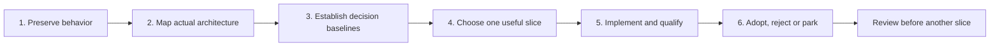
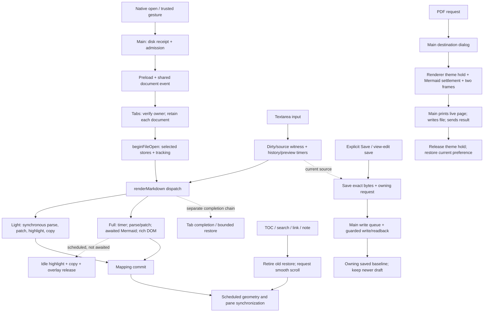
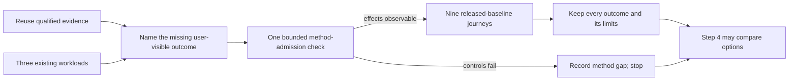
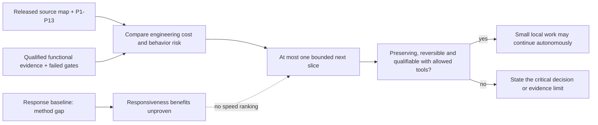

# Performance architecture plan

- Goal: make content readable and scrolling/typing effective sooner, while
  keeping complete, correct output.
- Preserve functionality and safety, not every current internal implementation.
  Improve a component or replace a subsystem when evidence supports it.
- Do not start a whole-app language/framework rewrite. Do not choose a language,
  worker, package, cache or virtualization strategy before comparing the options.
- Work through one deliverable at a time. Steps 1 and 2 are accepted.
  Step 3's definition is accepted at `66519d8e`. One bounded collection unit
  stopped at its first admission launch with a collector preflight error.
  No response samples were collected; Step 3 observations remain unfinished.
  A separate user-authorized one-code recheck reached Open/reading controls,
  then stopped at the collector's split-width check. No sample journeys ran.
  Collection is closed with a **method gap**; observations remain unfinished.
  Step 4 is a source-based options assessment, not a performance ranking.
  Steps 5-6 have not started.
- These are documentation deliverables, not runtime qualification or permission
  to choose or implement an optimization.

## Sequence and handoffs

| Step | Concrete deliverable | Prerequisite and exit check | Not part of this step |
|---|---|---|---|
| **1. Preservation contracts** | The inventory below: released behavior, a representative regression scenario, source/test references and known gaps. | Identify the released source. Every group has a supported contract or an explicit uncertainty. Independent Sol/Luna review, then coordinator handoff. | Product/test changes, runtime collection, architecture selection or performance claims. |
| **2. Actual architecture map** | One open/edit/render/export flow diagram and ownership notes. Identify state/result owners, source revisions, invalidation/cancellation, compute versus DOM/layout work, and each readiness signal. Separate source facts from hypotheses. | Accepted Step 1. Trace each boundary and suspension point needed for the next decision; explain what can still be unfinished when a promise resolves. | Replacement design, a full profiling campaign or assuming a large file is itself the bottleneck. |
| **3. Decision baselines** | Agreed user-visible outcomes and workloads; reusable qualified evidence; a short list of decision-critical missing observations. | Accepted map. Freeze workloads, start/end conditions, comparison method, acceptance criteria and stop rules before experiments. Use existing qualified tooling where possible. | Arbitrary new SLOs, new benchmark infrastructure by default, or collecting everything that could be measured. |
| **4. Options, return and one slice** | Compare current-component improvements, selective replacement and a whole-app rewrite; propose at most **one** bounded slice. Separate architectural value, preservation risk and engineering cost from unproven speed. | Qualified baselines are required for performance ranking. Without them, compare source-backed ownership/testability, migration and maintenance costs only. Bring significant architecture, behavior or scope tradeoffs to the user. | Predetermined technology, implementing a whole-app rewrite, invented hours/dollars/speedups, or several combined experiments. |
| **5. Implement and qualify one change** | Isolated Sol/high implementation; relevant durable tests and individually sensitive revert proofs; independent Sol/Luna feedback; fair comparison with the released baseline. | Selected, authorized slice and frozen method. Demonstrate the intended visible effect and complete output. Protect ownership, current-source results, errors and affected contracts. Keep slow/failing samples and setup failures. | Retry-until-green, sample filtering, unrelated fixes/dependencies, or treating an earlier callback as improvement. |
| **6. Adoption and next iteration** | Adopt, reject or park with demonstrated benefit, costs and limits. Keep the released fallback during qualification; remove the losing shipping path after the decision. | Qualification and reviews complete. Useful improvement must be demonstrated; otherwise reject/park. Coordinator reviews the outcome before another slice is chosen. | Permanent two-renderer complexity by default, automatic next-slice execution, integration or publication without separate authorization. |

- Coordinator reviews sequential handoffs; this is not a user-approval prompt
  for every mechanical action. Ask the user about real design/scope/behavior
  choices, unresolved preservation expectations and meaningful tradeoffs.
- Continue small, reversible, behavior/security/data-preserving work autonomously
  only when existing tools can meaningfully qualify it. Routine handoffs do not
  require another approval. This does not reopen stopped collection, waive gates
  or authorize a dependency strategy, rewrite, behavior change or publication.
- Roles for this continuation: latest Astra for design/investigation; latest
  Sol/high for documentation and implementation; fresh independent Sol/high
  and Luna/high review the actual deliverable. Correct material findings and
  review the correction before handing off.
- Preserve existing performance gates in
  [PLANNED-WORK](PLANNED-WORK.md#performance-acceptance-gates).
  Step 3 adds decision-specific criteria; it does not quietly replace them.
- Steps 1-3 definition ran no app/tests/builds/benchmarks/samplers/profiling.
  The coordinator authorized one bounded collection unit; it stopped below.
  The separate one-code recheck below also stopped. No further app/collection
  runs, mixed admission or sample journeys are authorized, including unused slots.
  No real profiles/logs, product/repository harness edits, PoC imports, pushes,
  PRs, tags, integration or publication.
- Dependency maintenance remains separate and on hold through October 28, 2026,
  subject to approved feed availability. Do not bundle it into architecture work.

## Step 1: preservation inventory

### Source and evidence boundary

- Released reference: **v0.10.0**, source
  `f5d380786fb895bf783e263f79aea6316f303ad1`, tree
  `45eb10efd93e6dee7dc583a80488bad1e6cdda5a`.
- Working baseline: canonical main
  `90111cfa30f35a39515072b3258265d8f32528ee`.
  Only the release-completion register differs from the tag; runtime source,
  tests, scripts, dependencies and shipped libraries match.
- Source/test line references below describe that released baseline, not an
  unadopted experiment. Executable code wins over stale comments or old audit
  line numbers. References identify representative coverage, not every assertion.
- **Source** means inspected implementation. **Test** means an existing
  assertion was inspected, not run here. **Release** means retained v0.10.0
  qualification, not a new execution or a universal guarantee.
- Retained release receipt: session `54f84d1f-cf48-44eb-96f1-f67e066f2402`,
  `files/release-0100-final-result.json`, SHA256
  `1298b716d24380f5829057cdc9597681c2ecbe16257b0a571f03e0cbacb5ec96`.
  Its source/tag/tree and file hash were checked read-only.
  The repository summary is [release-0.10.0](PLANNED-WORK.md#current-workset).
- Release evidence includes affected source gates, strict built-ASAR checks
  without skips, and 48/48 fresh-profile actual Windows package checks through
  the production preload. It is **not** a full `npm test` pass, installed live-upgrade
  check, cross-platform UI certificate or physical-paint/input guarantee.

### Contracts and representative regressions

| ID / behavior and important invariant | Representative user action and regression signal | Source | Existing tests | Evidence / known gap |
|---|---|---|---|---|
| **P1. Admit a document, not just a path.** Welcome/no admission differs from an admitted empty file. Cancel/refusal keeps the prior owner and controls. Large-document admission/switch consent remains scoped; reload is not given another size prompt. Main-issued session restore retains order/selection and reports unavailable entries. | Cancel opening over a dirty editor, then admit an empty file. Failure: the draft disappears, stale paths enable Reload/Edit, or the empty file cannot be edited/reloaded. | [beginFileOpen](../src/renderer.js#L8326-L8440), [switch consent](../src/custom-tabs.js#L2530-L2651), [Main confirmation](../src/main.js#L4439-L4489), [session restore](../src/custom-tabs.js#L3429-L3484). | [empty/refused admission](../test/test-document-editor.js#L148-L221), [session restore and fail-closed cases](../test/test-document-session.js#L181-L267). | Source + Test; release editor checks. Restore assertions are not a new restart run here. No path/content truthiness substitute for ownership. |
| **P2. Tabs, reload and disk changes stay independent.** Each tab keeps its current source and disk baseline; background refresh cannot replace dirty work. Watcher notices and accepted/failed reload results belong to their document. Cancel keeps edits and the actionable notice. | Refresh B, refresh A, return to B; edit A while disk changes; cancel Reload. Failure: B reverts, A's draft is replaced, or A's notice appears over B. | [switch/refresh](../src/custom-tabs.js#L2613-L2688), [owned reload request](../src/renderer.js#L3522-L3598), [Main request identity](../src/main.js#L9215-L9277). | [original two-tab regression](../test/test-tab-refresh.js#L16164-L16215), [actual watcher/dirty reload](../test/test-reading.js#L372-L431). | Source + Test; extensive legacy tab coverage exists but the full suite is not green. Same-size edits with restored mtime remain a known disk-version gap, not a new promise of detection. |
| **P3. Async work needs the right owner and current source.** Document identity, source/mutation revision, navigation intent and render generation are different checks. Preserve existing stale render/highlight/consent rejection and owner-specific overlay cleanup. Current-source ownership is required safety, not a claim that every dialog already enforces it. | Start work, type again or switch tabs, then let the old callback finish. Failure: stale content wins, a consent applies to newer text, an old completion hides the new overlay, or loading stays stuck. | [revision-specific consent](../src/custom-tabs.js#L480-L523), [render dispatcher/full path](../src/renderer.js#L6704-L7000), [overlay ownership](../src/renderer.js#L3465-L3495). | [held stale/current idle callbacks](../test/test-language-highlighting.js#L309-L340), [pending editor callbacks](../test/test-document-editor.js#L399-L426), [overlapping render overlays](../test/test-tab-refresh.js#L17941-L18130). | Source + Test; released syntax callback checks. Stale-result rejection is not proof that obsolete CPU work is interruptible. Same-generation edits need revision/source checks, not generation alone. Table-dialog ownership has a source-observed gap in P8. |
| **P4. Editors and drafts belong to documents.** Each editor retains open intent, text, selection, undo/redo, both scroll axes and discard checkpoint. Repeated Edit is a no-op. Close retires the session; reopening starts reading. Draft/history remain in memory, not restored as saved reading preferences. | Edit A and B, switch repeatedly, repeat Edit, discard only A, close/reopen A. Failure: text/history leaks between tabs, focus/selection resets, or discarded/closed work returns. | [private editor state](../src/custom-tabs.js#L392-L451), [capture/exit](../src/renderer.js#L3672-L3838), [persisted layout fields](../src/custom-tabs.js#L3363-L3384). | [independent editors/history/scroll](../test/test-document-editor.js#L228-L458), [disk replacement and retirement](../test/test-document-editor.js#L536-L635). | Source + Test; release editor checks. Privacy contract is no new draft persistence/telemetry, not a claim that saved files, paths or reading anchors contain no document information. |
| **P5. Save, refusal and shutdown protect unsaved work.** Save advances only its owning document's written baseline. Later typing remains dirty; a background result cannot clear another editor. Unresolved Save keeps the editor open. Discard/cancel, disk replacement/deletion, write failure and close/update shutdown keep their existing protections. | Save A, type newer text, switch to B before completion; return and discard A. Failure: newer typing becomes clean, B changes, stale undo returns, or cancellation exits/installs anyway. | [Save-result adoption](../src/custom-tabs.js#L3977-L4031), [serialized writes](../src/main.js#L5109-L5121), [pending Save/Exit](../src/renderer.js#L3738-L3815), [close guards](../src/custom-tabs.js#L3075-L3245). | [held real writes/background completion](../test/test-document-editor.js#L480-L552), [owned dialogs](../test/test-owned-dialogs.js), [update/shutdown controls](../test/test-about-updates.js). | Source + Test; release editor/update checks. Existing Save-alias and hosted shutdown/legacy failures remain separately tracked in PLANNED-WORK; no claim that all races are solved. |
| **P6. Scroll follows the same source occurrence.** Source/preview mapping preserves semantic location, not equal pixels or whole-document percentages. New input suspends stale geometry; layout/media/zoom invalidate it. User input owns the driver; follower events do not. Explicit navigation retires old restoration; ordinary tab/resize restoration still works. Metadata stays separate, inert and verified; it must not alter HTML/SVG/raw text/tables. | Scroll repeated prose, a tall image/diagram or code line in either pane; navigate by TOC/search, then resize. Failure: wrong repeated occurrence, feedback bounce, selection/undo changes, old position replayed, or different parsed HTML. | [verified inert metadata](../src/editor-scroll.js#L318-L452), [input/current-source lifecycle](../src/editor-scroll.js#L800-L886), [preview navigation](../src/renderer.js#L1131-L1136). | [native navigation/actual resize and ordinary restore](../test/test-editor-scroll.js#L299-L437), [input/layout/edits](../test/test-editor-scroll.js#L583-L837), [HTML equivalence/rejection](../test/test-editor-scroll.js#L1015-L1155). | Source + Test; release transitions/layout/input and actual packaged navigation checks. Coarse/ambiguous mapping is explicit, not invented precision. No universal OS-input or zero-pixel-error guarantee. |
| **P7. Parsing and trust boundaries survive.** Full/light paths keep Markdown, BOM/CRLF, emoji, authored HTML and supported local/data images faithful. Sanitize assembled output; sandbox explicit raw-HTML documents. Main owns file admission/writes and trusted external actions; no page Node/general IPC or broader popup capabilities. Rendering libraries remain local. | Open mixed/hostile markup in reading/edit/full/light paths and previews/popups. Failure: altered canonical structure/text, executable host injection, unauthorized file action or unexpected external open/request. | [shared sanitizer](../src/renderer.js#L185-L241), [raw HTML sandbox](../src/renderer.js#L700-L766), [production isolation/navigation guards](../src/main.js#L3289-L3382), [trusted gestures](../src/main-preload.js#L36-L84), [popup-specific bridge](../src/popup-preload.js#L1-L45), [CSP/local libraries](../src/index.html#L31-L68). | [render security](../test/test-render-security.js), [popup security/export controls](../test/test-popup-security.js), [canonical HTML](../test/test-editor-scroll.js#L1034-L1082), [offline sentinel](../test/test-language-highlighting.js#L469-L483). | Source + Test; release syntax/isolation checks are narrower than the whole security suite. Offline libraries do not mean every document causes zero network: CSP permits authored HTTPS images. Preserve intended resource policy, not a blanket network claim. |
| **P8. Rich content stays usable; source edits must target their owner.** Preserve table widths, original headers, horizontal/nested scrolling and popup/export text; Mermaid's valid neighbors, source, authored styling, theme/zoom and popouts; images, H1-H6, collapse, notes and checkbox edits. Reuse must not retain stale presentation or metadata. Correct source targeting is required safety, with table gaps at right. | Insert prose before highlighted code/diagrams; edit one repeated source block; switch theme, collapse and resize a wide table. Failure: wrong block changes, text disappears, duplicate controls, lost handlers or stale SVG/mapping. | [DOM reuse](../src/renderer.js#L6199-L6260), [rich render stages](../src/renderer.js#L6802-L6998), [table behavior](../src/renderer.js#L7238-L7453), [table source lookup](../src/renderer.js#L11624-L11648), [table edit commit](../src/renderer.js#L12601-L12678), [Mermaid edit checks](../src/renderer.js#L12345-L12387). | [patch/source-edit regressions](../test/test-render-patch.js), [tables](../test/test-table-display.js), [Mermaid ambiguity refusal](../test/test-mermaid-render.js#L3249-L3268), [original headers/theme/popouts](../test/test-reading.js#L194-L368), [code reuse](../test/test-language-highlighting.js#L433-L448). | Source + Test; no fresh rich-content run. Table lookup takes the first best score without rejecting ties. Table commit checks mutation permission, but lacks Mermaid's captured render-generation and unique-target checks. Mermaid also checks target presence/current-source uniqueness; that is not a captured document/source-revision guard. Node identity is useful current reuse, not a fixed algorithm requirement. |
| **P9. Syntax coverage, plain fallback and copy remain exact.** Rust, Go, PHP, Ruby, Swift, Kotlin, Dart, R, PowerShell, YAML, TOML and Markdown plus legacy grammars/official aliases. Unknown/unlabelled fences stay plain; inline code/source editor stay plain. Tokens never change copied source. | Open every supported fence/alias, an unknown label and escaped markup; copy Rust, search a token, then make an unrelated edit. Failure: missing grammar, live source tags, changed copy text or unnecessary loss of correct processed blocks. | [official component bundle](../scripts/vendor-prism.js#L7-L55), [selective highlighting](../src/renderer.js#L6694-L6700), [copy buttons](../src/renderer.js#L7690-L7757). | [legacy output/aliases](../test/test-language-highlighting.js#L78-L126), [rendered fences/copy/search/themes](../test/test-language-highlighting.js#L341-L448). | Source + Test + released source/package language checks. Dockerfile and invented aliases are not supported additions. Syntax speed is separate from semantic/copy correctness. |
| **P10. Search uses actual rendered text and current input.** Case-insensitive literal search, terms of at least two characters; Enter/Shift-Enter and next/previous flush pending input. Close cancels pending work and clears marks. Decoration does not alter source text. | Type a different term and immediately navigate; search inside a Prism token; close before debounce fires. Failure: previous-term navigation, changed code text or marks reappearing after close. | [text-node matching and navigation](../src/renderer.js#L5009-L5230). | [token text](../test/test-language-highlighting.js#L378-L390), [legacy intended scenarios](../test/test-search.js). | Source + Test + direct actual packaged search checks in the release receipt. Legacy `test:search` fails before functional assertions and is **not passing coverage**. Matching across separate token/text nodes and inside SVG/Mermaid is not promised by this implementation. |
| **P11. Export is complete output, not viewport readiness.** Preserve supported PDF/table/image/diagram output and Main-owned destinations/actions. Print hides controls/drawers/editor, expands collapsed sections, keeps natural table headers and uses the export theme; restore the reader's current theme/zoom after completion/failure. Pending work, document identity and operation lifetime need their own checks. | Export a long mixed document with a collapsed section from dark split view, including off-screen content; change theme or navigate during preparation. Failure: omitted content, printed controls, wrong-document output or leaked export appearance. | [PDF lifetime/write](../src/main.js#L5008-L5091), [theme holds](../src/renderer.js#L3347-L3452), [prepare/result](../src/renderer.js#L3605-L3645), [print CSS](../src/styles.css#L2352-L2394), [print expands sections](../src/custom-styles.css#L843-L847), [post-export open](../src/main.js#L4986-L5005). | [stubbed PDF-device handshake](../test/test-language-highlighting.js#L407-L428), [real PDF bytes/natural headers](../test/test-reading.js#L284-L309), [popup CSV/JSON](../test/test-popup-security.js#L1220-L1324), [zoom/PDF](../test/test-reading-zoom.js#L260-L269). | Source + Test, with a **coverage gap**: stub bytes or nonempty PDFs do not prove every page/content. Main prints the live page after a pathless ready signal; document-switch/concurrent-export correlation, pending highlight/media completion and cancellation/destruction are not certified here. Do not promise snapshot isolation or preserve a possible race as intended behavior. |
| **P12. UI, layout and reading preferences retain meaning.** Theme, reading zoom, exclusive TOC/Notes drawer, current heading, focus and keyboard actions stay coherent across tabs, mode changes and resize. Narrow-window controls remain reachable. Scroll-only actions do not edit/select text. | Use TOC by keyboard, zoom in split view, resize narrow, switch two dirty editors, reopen the drawer. Failure: obscured controls, focus theft, wrong section, lost draft or rewritten user preference. | [TOC/drawers](../src/renderer.js#L5293-L5860), [reading zoom](../src/renderer.js#L1873-L2250), [document editor](../src/renderer.js#L3672-L3838); [current UI contract](CUSTOMIZATIONS.md#reading-drawers-table-headers-and-update-notices). | [TOC semantics/focus/resize](../test/test-toc.js#L86-L318), [responsive layout](../test/test-responsive-layout.js), [zoom](../test/test-reading-zoom.js#L190-L324), [narrow editor toolbar](../test/test-document-editor.js#L271-L310). | Source + Test; released Windows TOC/layout/input checks. Named/visible controls and native-key tests are not full screen-reader, IME, touch, high-refresh or Linux/macOS UI certification. |
| **P13. Updates remain explicit and Main-owned.** About reads local shared state; remembered availability is not an installer. Download/install stay separate; ordinary quit must not install. Installation uses existing unsaved-work/shutdown checks; macOS remains manual. | Open About offline; cancel update shutdown with dirty editors; quit normally after download. Failure: implicit network/install, false ready state or discarded drafts. | [Main validation/auto-install policy](../src/main.js#L13584-L13624), [explicit actions/shutdown](../src/main.js#L13704-L13771), [UI actions](../src/app-updates.js#L41-L53). | [update state](../test/test-update-state.js), [About/update controls](../test/test-about-updates.js). | Source + Test + release update/package metadata checks. No installed live-upgrade certification. Do not alter updater protocol, platform support, trust or signing behavior as part of performance work. |

### How this inventory is used

- These are preservation contracts, not a claim that every existing bug is
  intended behavior. Known defects stay visible; changing user-facing semantics
  needs an explicit decision.
- Step 2 must carry these IDs into the actual ownership/readiness map. Do not
  expand it into a redesign while tracing the current implementation.
- At Step 4, mark which contracts the selected slice can affect. At Step 5,
  choose the relevant existing tests and close only decision-critical gaps.
  A source assertion, runtime state change and visible effect are different
  evidence. Test setup/error sentinels must be proven alive; exact revert
  failures must leave independent controls passing.
- Preserve small cross-feature scenarios: two dirty documents with a late
  completion; current-source navigation followed by resize; reused rich content
  after an edit; highlighted-token search/copy; full export while work is pending.
  Do not create hundreds of new cases or a second proof catalog by default.

## Step 2: actual architecture map

- Source-only map from accepted Step 1 commit
  `eb493dd8ccbb4f05933a715f9137097c142e44ab`; product bytes still match v0.10.0.
  The diagram shows control flow, not measured duration or guaranteed completion.
- Scope: central admission, selection, editor render, late results,
  navigation/resize and export. P1-P13 remain the preservation inventory.
  Main's trusted file/update authority and narrow preload capabilities remain
  boundaries, not replacement-design proposals.

### Owners and identities

| Owner / coordinate | What the current code owns or checks |
|---|---|
| **Main: admission and disk authority** | Admission includes random document `ref`, persistent `entryId`, logical spelling, physical target/path key, disk receipt and sender/page scope. A path alone is not authority. File delivery has its own epoch; watcher selection has another generation. [Admission](../src/main.js#L3011-L3104), [delivery scope](../src/main.js#L4461-L4489). P1/P2/P7/P13. |
| **Preload and document events** | Preload validates/projects fixed payloads and captures private trusted gestures. Document events make one page-local clone shared by subscribers; dispatch does not await subscriber promises. Neither layer certifies rendering. [Preload events](../src/main-preload.js#L322-L401), [shared dispatch](../src/document-events.js#L41-L52). P1/P3/P7. |
| **CustomTabs: per-document state** | Owns current tab bytes, written baseline, editor/history/selection/scroll state and conflict witnesses. `snapshotActiveTab()` folds the shared live editor/source into its owning cache. Document identity combines page session, Main renderer epoch, tab/document generation and path key; it includes `documentRef` when the tab has an admission. Not every local identity lookup checks that ref. [State](../src/custom-tabs.js#L392-L451), [snapshot](../src/custom-tabs.js#L2426-L2520), [identity](../src/custom-tabs.js#L3639-L3670), [local lookup](../src/custom-tabs.js#L3887-L3910). P2/P4/P5. |
| **Same-document source/mutation** | Ordinary typing does not replace document generation. Mutation revisions, captured text/cache and operation-specific sequences provide additional checks. There is no universal captured source-revision token across every path. Textarea text is the live source while editing; `originalMarkdown` can remain the saved/discard baseline underneath newer typing. [Consent revisions](../src/custom-tabs.js#L480-L555), [live source](../src/custom-tabs.js#L649-L668), [Save comparison](../src/renderer.js#L4790-L4803). P3/P4/P5. |
| **Renderer: selected stores and visual work** | `fileOpenSequence` owns selected-file completion; editor mode has its own revision. Renderer `renderGeneration` advances on render dispatch, not raw input. CustomTabs has a **different, locally scoped counter also named `renderGeneration`** for visual continuations. Neither counter is document generation or a universal source revision. [Open boundary](../src/renderer.js#L8326-L8361), [renderer dispatch](../src/renderer.js#L6704-L6719), [tab counter/completion](../src/custom-tabs.js#L2522-L2525), [tab continuation](../src/custom-tabs.js#L2906-L2955). P3/P6/P8/P9. |
| **Editor-scroll: correspondence and geometry** | A source mapping captures `fileOpenSequence` as its selection identity. Committed source, exact textarea match, pending-source state and geometry state are separate checks. This identity is not the watcher selection generation. [Wiring](../src/renderer.js#L1011-L1016), [source capture](../src/editor-scroll.js#L119-L137), [usable geometry](../src/editor-scroll.js#L509-L619), [commit/diagnostics](../src/editor-scroll.js#L841-L886). P6/P12. |

### Central flow and asynchronous boundaries

| Flow | Work, suspension points and actual guards |
|---|---|
| **Open and select — P1-P4** | Main asynchronously opens/reads/stats a stable disk snapshot; path validation and some metadata work remain synchronous. Delivery checks survive disk reads and large-document consent. Tabs can wait for ownership handshake, pending Save, conditional refresh and adoption. Before selection, switch intent, selected tab, existence, freeze, generation and mutation/text witnesses can invalidate the attempt. `beginFileOpen()` then moves selected path/source/editor/history/tracking coherently, with rollback on refusal; tracking includes **synchronous IPC**. [Disk read](../src/main.js#L3208-L3248), [delivery/admission](../src/main.js#L4604-L4821), [refresh witnesses](../src/custom-tabs.js#L2040-L2210), [switch](../src/custom-tabs.js#L2613-L2740), [begin](../src/renderer.js#L8326-L8643), [sync tracking bridge](../src/main-preload.js#L998-L1025). |
| **Input and render — P3/P4/P6-P10** | Input marks dirty/mutation state and suspends old geometry. History and preview timers check captured open/mode revisions, then read the **current textarea**. Preview delay is configured at 400 ms; history at 800 ms: scheduling settings, not measured response bounds. Switching cancels editor timers. Mode selection scans previous/new source; only `light-format` takes the light path. Both paths parse/sanitize/verify/patch on renderer JS. Light also highlights/copies synchronously. Full first awaits a 10 ms timer, can await local Mermaid load and the shared Mermaid queue, then schedules an optional idle highlight/copy/overlay tail without awaiting it. [Input/timers](../src/renderer.js#L4066-L4100), [mode selection](../src/renderer.js#L6098-L6116), [light/full](../src/renderer.js#L6627-L7000). |
| **Late render/reload — P2/P3/P6/P8** | Render generation checks reject selected stale commits and callbacks, not every earlier computation. Module loading/queued or running Mermaid work is not universally aborted. Raw typing can precede the next render dispatch; generation checks alone are not a captured-text check. Reload carries owner/ref, selection, request sequence and source snapshot; adoption and completion add path/current-source checks. Background results update their owner without repainting another foreground tab. [Mermaid adoption](../src/renderer.js#L2727-L2815), [reload request](../src/renderer.js#L3522-L3598), [reload validation/adoption](../src/custom-tabs.js#L4887-L4969), [visual completion](../src/custom-tabs.js#L5395-L5518). |
| **Save completion — P3-P5** | Save captures exact bytes, owner, sequence and editor history. Main queues writes per physical target and rechecks scope. The descriptor write/truncate/fsync loop is **synchronous Main work**, surrounded by asynchronous open/stat/close/readback. One memoized result decision separates pending-request settlement from permission to mutate a baseline. An accepted older Save advances written bytes, not newer draft text; background adoption stays document-owned. [Request](../src/custom-tabs.js#L3835-L3885), [renderer dispatch](../src/renderer.js#L4390-L4457), [Save queue](../src/main.js#L5818-L5848), [synchronous write/truncate/fsync](../src/main.js#L6630-L6642), [write/readback path](../src/main.js#L6389-L6748), [result settlement](../src/renderer.js#L4683-L4762), [baseline adoption](../src/custom-tabs.js#L3977-L4031). |
| **Navigate, resize and scroll — P6/P10/P12** | TOC/search/internal-link/note navigation retires old restoration, claims preview ownership, then requests native smooth scrolling; it returns no movement-completion promise. Ordinary restore uses heading text/occurrence/delta or raw offset, applies now and through bounded frame/resize retries. Mapping commit schedules geometry; rebuild checks selection, exact source, pending state and active/frozen state. Resize, DOM/media/font changes can invalidate it again. Driver intent is distinct from actual vertical change; follower events cannot take ownership. [Navigation](../src/renderer.js#L1131-L1136), [restore](../src/custom-tabs.js#L1484-L1617), [geometry](../src/editor-scroll.js#L509-L772), [input filters/writes](../src/editor-scroll.js#L775-L886). |
| **Export lifetime — P11** | Main awaits destination choice, sends prepare, then waits for pathless `pdf-export-ready`. Renderer holds export appearance, awaits Mermaid theme settlement and signals after two animation frames. Main prints the **live page**, writes bytes and sends the result; the OS-open request is started, not awaited before success. Final theme-hold release restores the reader's current stored preference. No per-export/document identity makes this a snapshot barrier. Pending highlight/media/fonts, all-page content and cancellation/destruction/concurrent lifetime remain uncertified. [Main export](../src/main.js#L4986-L5091), [theme/hold](../src/renderer.js#L3347-L3452), [prepare/result](../src/renderer.js#L3605-L3645), [Mermaid settlement](../src/renderer.js#L2838-L2864). |

### Work placement, reuse and invalidation

- **Renderer synchronous compute:** mode scans, normalization/emoji/placeholders,
  Marked parsing, block hashes and LCS matching. Mapping creates canonical HTML
  and a separate annotated parse; failed equivalence can trigger a coarse retry.
- **Renderer DOM/layout:** DOMPurify, detached-tree verification, live patch and
  binding transfer, rich-content controls, TOC/collapse, table measurements,
  Prism token spans and textarea-mirror/Range geometry. These are not pure
  string work or an off-thread path.
- **Deferred does not mean off-thread:** a timer, idle callback or promise queue
  changes scheduling. Once synchronous parse/highlight/measurement starts, it
  occupies its JS thread until it returns. Invalidation can reject later
  adoption without cancelling that work.
- **Reuse existing mechanisms:** LCS patching keeps matching DOM/processed code;
  Mermaid reuses source-keyed SVGs and a shared render/theme queue. Inert source
  metadata is verified before binding to adopted nodes; geometry uses cached
  coordinates until invalidated. Do not design a second cache/state machine
  merely to describe these mechanisms.
- **Helpers already available:** `beginFileOpen`/`completeFileOpen`,
  `captureDialogContext`, `snapshotActiveTab`, `settleSaveResult`,
  `scrollElementIntoView`, `queueMermaidWork`/`whenMermaidSettled` and
  `getEditorScrollDiagnostics`. Their scope differs; none is global readiness.
- Sources: [patch/reuse](../src/renderer.js#L6199-L6260),
  [metadata verification](../src/editor-scroll.js#L318-L506),
  [rich stages](../src/renderer.js#L6930-L6998),
  [table layout](../src/renderer.js#L7453-L7506),
  [Mermaid scheduling/adoption](../src/renderer.js#L2727-L2864).
- **Guard limits, not reproduced failures:** some Undo/Redo and view-edit
  completion callbacks restore scroll without an explicit captured owner/source
  check. P8's table tie/dialog gaps remain; Mermaid's render-generation and
  target/current-source-uniqueness checks are not captured source revision.
  [Undo/Redo](../src/renderer.js#L1196-L1247),
  [view-edit continuation](../src/renderer.js#L2455-L2466).

### Readiness: what each signal actually means

| Signal | Established / still not established |
|---|---|
| **Admission or native ticket accepted** | Scoped authority or an open request has started, not selected/adopted/displayed content. Ticket acceptance starts `openFile()` without awaiting it. [Ticket handling](../src/main.js#L2526-L2573). |
| **Successful `beginFileOpen()`** | Selected stores/tracking moved coherently; no DOM/paint wait. `completeFileOpen()` is also synchronous: checks its sequence/freeze/approval, then applies or schedules positioning. Its caller arranges any preceding render wait. [Completion](../src/renderer.js#L8645-L8742). |
| **`await switchToTab()`** | The selection path returned, possibly without selecting. It launches `renderMarkdown(...).then(...)` without awaiting that chain. It is **not render completion**. [Detached chain and return](../src/custom-tabs.js#L2906-L3021). |
| **`await renderMarkdown()`** | Light synchronous work or full awaited stages returned. Stale exits and displayed-error paths can also resolve. Full idle highlight/copy/overlay may remain. It does not establish expected document/source DOM or physical paint by itself. [Dispatcher/full tail](../src/renderer.js#L6704-L7000). |
| **Matching DOM; highlight/copy installed; overlay released** | Distinct observable stages, not one promise. A matching heading alone need not prove every block. Clipboard completion separately awaits its write; search decoration separately walks/modifies text nodes. None certifies stable geometry or complete export. [Copy](../src/renderer.js#L7658-L7757), [search](../src/renderer.js#L5009-L5230), [overlay ownership](../src/renderer.js#L3465-L3495). |
| **Mapping committed / diagnostics ready** | Commit installs correspondence and schedules geometry. Check current source/selection **and** pending geometry; later layout can invalidate it. TOC/table tracking also has separate observers/frames. [Commit/diagnostics](../src/editor-scroll.js#L841-L886), [TOC/table tracking](../src/renderer.js#L5327-L5618). |
| **Input delivered or driver claimed** | An event/intent was accepted, not actual movement, current-source preview text, or a follower write. Nested/horizontal/prevented wheel cases have different routing. [Input ownership](../src/editor-scroll.js#L775-L840). |
| **PDF ready / result** | Ready means theme preparation reached its signal; two frames do not certify physical paint. Result reports the device/write outcome, not every page's content, document correlation or successful OS viewer launch. See P11 and the export flow above. |

### Questions carried from the source map

- Which current-source outcome is delayed for each selected workload: admission,
  readable DOM, overlay release, usable geometry or visible typing/scroll effect?
- Which part is elapsed waiting versus synchronous Main/renderer occupancy?
  Source placement identifies boundaries, not their cost or the bottleneck.
- How much obsolete work survives rapid input/tab changes before its result is
  rejected? Raw input, render dispatch and mapping readiness are different times.
- What proves effective native input and sufficiently stable geometry for the
  chosen scenario? Delivery, ownership and first rebuild are insufficient alone.
- What complete-output/lifetime evidence is needed if export is affected?
  The ready signal and nonempty/stub PDF bytes cannot prove every output page.
- Which retained evidence matches the exact lifecycle/endpoint? Existing
  [held-idle checks](../test/test-language-highlighting.js#L309-L340),
  [native navigation/resize controls](../test/test-editor-scroll.js#L299-L437),
  [late Save cases](../test/test-document-editor.js#L480-L535) and
  [PDF-device checks](../test/test-language-highlighting.js#L407-L428) are useful
  starting points, not new results. The [existing benchmark](../bench/run.js#L1363-L1458)
  observes direct render return and later mutations/census; its labels do not
  certify native open, paint, input effect, media or all background work.
- The source map does not select a workload set, method/SLO or optimization.
  Step 3 freezes a decision method before any missing observation is collected.

## Step 3: decision baseline definition

- This frozen method remains below to interpret its retained receipts, not as
  live execution permission. Its bounded collection and separate one-code
  recheck are closed with a **method gap**. Observations remain unfinished;
  no representative response baseline was established.
- Priority: current readable content, actual text entry and effective scrolling.
  Highlight/copy/overlay completion is a separate outcome, not a substitute.
- Retained evidence protects named functionality and preserves failed gates.
  It does not establish released input effects while current work is pending.
  No further collection, unused launch slots or comparison is authorized.
  Step 4 may assess engineering tradeoffs, not claim responsiveness benefits.

### Three workloads and their user journeys

| Workload / existing construction | Required journey and preservation links |
|---|---|
| **Ordinary prose:** `# Plain corpus` plus `generate("prose", 50 * 1024)`. The generator finishes a whole iteration, so the target is not an exact byte count. [Definition](../test/test-editor-scroll.js#L60-L66), [prose](../bench/corpus.js#L70-L75), [generation](../bench/corpus.js#L220-L257). | Fresh-process first open; enter editing; insert two distinct short markers in ordinary prose without waiting for preview settlement; observe latest preview/mapping and actual scroll effects. P1/P3/P4/P6/P7/P12. This does not replace the separate 64 KiB performance control. |
| **Code-rich:** existing multi-language fixture, including aliases, plain-fence controls, incomplete Rust string/comment payloads inside complete fences, long Rust text, editable prose and tail paragraphs. [Fixture](../test/fixtures/language-highlighting.js#L5-L110). | Same journey. Keep exact code text, representative tokens and copy controls as separate presentation checks. P3/P6/P7/P9/P10. It is not the original R2/R3 representative workload. |
| **Mixed rich:** existing repeated prose, Mermaid flowchart, tall images, table, JavaScript fence and wrapped paragraphs; retain its `short.svg` sibling. [Construction](../test/test-editor-scroll.js#L32-L65). | Same journey, with the fixture's rich-content structure and loaded local images, not just its first heading. P3/P6-P9/P12. No size multiplier or new network resource. |

- Each workload opens **first in its own fresh process**. Three documents opened
  in one process do not give three fresh module/grammar contexts.
- Use the fixed parameters below; record the resulting viewport/runtime and
  keep them identical in later comparisons.
- Current-source replacement is required now. Cross-tab late completion stays
  a preservation constraint, not another collection journey. Add qualification
  if a selected slice changes shared scheduling, caches, workers or cancellation.
- Navigation/resize checks become required if mapping/restoration/layout changes.
  P11 complete pages/lifetime become required if export is affected. No PDF,
  platform, theme or file-size campaign is part of this unit.

### Which retained evidence can be reused

- **Valid baseline** below means valid only for the named claim and lifecycle.
  It does not turn functional results into a timing baseline.
- All current runtime/test references describe released source
  `f5d380786fb895bf783e263f79aea6316f303ad1`. Older observations stay attached
  to their older sources. An unpinned receipt cannot establish a fresh claim.

| Evidence / source and retained reference | Method, workload and endpoint | Permitted use / limit |
|---|---|---|
| **Release receipt:** f5, exact tree/hash and receipt in [Step 1](#source-and-evidence-boundary); [release register](PLANNED-WORK.md#current-workset). | Source gates, strict ASAR checks and fresh-profile actual Windows package checks: languages/copy, direct search, TOC/navigation/resize and listed UI controls. | **Valid functional baseline** for those exercised cases. **Context only** for responsiveness. No full-suite, cross-platform UI, installed upgrade, pending-input latency or physical-paint certificate. |
| **Original Prism R2/R3:** `c6ad6dfa902561b021d6d6f099b7b64c1de11871` versus `bb78080f677a8d12a11e351a14fa463c759da127`; [method and receipts](PERF-AUDIT.md#L3-L73), session `5850f9b8`, `files/language-perf-r2/results.json` and `files/language-perf-r3-20pairs/results.json`. | R2 has three fresh-profile observations per variant; R3 has twenty alternating matched pairs. Original representative first-open endpoint, not this contract's visible/input endpoints. | **Valid historical gate evidence**, not current f5 latency. R2 remains failed at +52.3 ms; R3 remains failed at +51.3 ms, observed p95 151.8 -> 203.1 ms against 50 ms. The accepted release exception does not pass or change the gate. |
| **Held idle callbacks:** f5 [test](../test/test-language-highlighting.js#L309-L340), retained release syntax result. | Direct renders hold real highlight callbacks; release stale then current work. Observe plain text, tokens and owner-specific overlay cleanup. | **Valid narrow functional baseline** for the exercised generation/overlay behavior. **Unusable for natural latency**, same-generation source freshness or effective input while work runs. Held work is not naturally scheduled work. |
| **Settled admission:** handoff receipt/harness/workload not pinned here. Existing [pane/source/stable-frame checks](../test/test-editor-scroll.js#L137-L173); older [scroll comparison](PERF-AUDIT.md#L128-L169) names source `02108b98`. | Settled open/split preconditions and later scrolling, not input while current work is unfinished. | **Context only** for setup/method reuse. No transfer to f5 absolute latency or pending interaction. Pin a retained receipt before making any stronger claim; do not recollect it by default. |
| **Early wheel:** corrected `8f79aefa5905f3d8f87d907412f397094d593626` versus parked `a566081028563abe9dfed73cb2c93ba629f2afe8`; handoff-only receipt/harness identity not pinned here. | Eight paired early attempts had zero actual effects; baseline overlay events and candidate preview events did not establish motion. A later single probe did not isolate native readiness from pre-dispatch interaction. | **Unusable as response latency** or release performance. Retain as negative method evidence. No Chromium/user-scroll diagnosis; no parked PoC time transferred to f5; no repair by settling only one variant. |
| **One idle interval:** `8f79aefa5905f3d8f87d907412f397094d593626`; handoff-only receipt/harness identity not pinned here. | One 16-block observation: queue wait versus callback elapsed for highlight **plus copy and overlay**, not isolated Prism CPU. | **Context only**. Too small/indeterminate for scheduling changes, CPU attribution or released input response. Do not add a measurement merely to enlarge it. |
| **Direct benchmark:** f5 [current method](../bench/run.js#L1363-L1458); [retained corpus results](../bench/BASELINE.md#L1353-L1407) use Electron 43.2.0 without an exact product commit in that result block. | Direct render-return interval, resolve-side counts, later mutations and final census. Different lifecycle from native first open. | **Context only** for separating returned versus later work. Labels do not prove readable paint, effective input, all background work or f5 absolute latency. No new benchmark run. |

### One proposed missing-baseline collection unit

- **Question:** which observable boundary delays current useful content or
  interaction on f5, and can the existing input methods observe real effects?
- **Exit:** either usable, source-pinned observations with limits, or a bounded
  method-gap finding. Neither chooses a subsystem or proves a CPU bottleneck.
- Reuse small existing mechanisms, not entire suites: production-preload
  [Open witnesses](../test/test-editor-scroll.js#L129-L141),
  [picker-device substitution](../test/test-editor-scroll.js#L110),
  [native hit-tested click](../test/test-editor-scroll.js#L284-L295),
  [text insertion](../test/test-language-highlighting.js#L429-L448),
  [wheel helper](../test/test-editor-scroll.js#L274-L284),
  [actual scroll effects](../test/test-editor-scroll.js#L674-L697),
  [current-source diagnostics](../src/editor-scroll.js#L841-L890) and
  [native-action interval/failure handling](../bench/native-actions.js#L234-L392).
  No replacement harness, product instrumentation or broad dependency/tooling work.
- Do not call those whole helpers for measured endpoints: `open()` uses a
  synthetic click then waits for Mermaid/settlement; `nativeWheel()` also
  settles after dispatch. Reuse only the specified dispatch/witness mechanics.
  The measured observer is non-settling; existing settled tails belong only
  to controls. This extraction is proposed, not an already-qualified helper.
- Open uses the exposed Welcome control `#welcomeOpenBtn`, through its
  [production handler](../src/renderer.js#L3300-L3307),
  [narrow bridge](../src/main-preload.js#L797-L799) and
  [Main admission path](../src/main.js#L4751-L4830).
  Hit-test it before timing. The separate `#openFile` menu item starts hidden;
  do not consume admission by trying to click it without opening its menus.
  Direct `renderMarkdown()` is not a first-open action.

| Fixed parameter | Rule before collection |
|---|---|
| **Window and mode** | Use `win.setSize(1440, 920)`, as in the [existing suite](../test/test-editor-scroll.js#L443). This fixes window size, not inner viewport; record the actual content bounds. Light theme, 100% reading zoom, production throttling policy, initially reading mode; no resize/zoom/theme changes during a journey. |
| **Enter editing** | Start only after the first-open presentation endpoint and the untimed reading-scroll control below. If either is not reached/passed, retain that outcome and mark dependent edit actions not reached; do not invent successful setup. Use the existing Edit action, then the [splitter reset](../src/renderer.js#L4045-L4047) to `0.5`. Verify editor width `50.00%`; the viewer has the remainder minus splitter/borders, not equal inner pixels. [Ratio/layout](../src/renderer.js#L3955-L3982). |
| **Source edits** | All three constructions start with a heading, blank line and prose. Focus/hit-test `#markdownEditor`; verify it is the active element. Set the collapsed caret at `source.indexOf('\n\n') + 2`, the start of that existing prose. Insert `step3one ` then `step3two ` at the advancing caret, with a value/selection checkpoint but no preview-settlement wait. Expected latest first paragraph starts `step3one step3two ` and retains the original text. Precompute exact source/selection after each insertion. |
| **Scroll targets** | Reading mode: `.content-wrapper`; split preview: `#viewer`; source: `#markdownEditor`. Use the center of the exposed scroll pane and verify the hit target is inside it. Record its actual bounds/scroll extent. [Mode-specific preview scroller](../src/renderer.js#L1018-L1030). |
| **Wheel and trigger** | One Electron `mouseWheel` attempt per declared action: `deltaX: 0`, `deltaY: -100`, no Ctrl/Meta. This is the existing downward injection sign, not DOM `WheelEvent.deltaY`. [Positive control](../test/test-editor-scroll.js#L680-L689). Preview trigger is the first observation of current text, exposed pane and positive vertical overflow; edit trigger follows the second input checkpoint with no source/geometry-settlement wait. Record lifecycle at actual delivery. Driver effect means `scrollTop` increased from the captured value; follower effect requires its actual position change plus current-source correspondence, not only a write counter. |
| **Observation cadence** | One lightweight rAF check per frame while the journey is active. Main independently enforces the cutoff/watchdog; a stalled renderer must not disable the stop. Record check count and elapsed observer work. Expensive validation/captures do not run every frame. |

| Action / start | Observable endpoints and ownership |
|---|---|
| **First open:** ready Welcome, no admitted document; start immediately before native mouse dispatch to the hit-tested Open control, substituting only the file-picker device. | Record current heading/ordinary viewport text, nonzero exposed layout and no opaque cover or hit-blocking element; this is a DOM/layout observation, not physical readability/paint. Separately check fixture beginning/middle/end and rich structures, exact code text, relevant tokens/copy controls, local images/Mermaid and overlay release. Verify admitted active owner, expected path and exact source. Fixture witnesses are not a certificate of every possible document/output page. |
| **Type current source:** admitted editor and fixed caret/markers above; start each interval immediately before `webContents.insertText`, without waiting for preview settlement between insertions. | Observe each actual textarea value/selection and the newest markers with original prose in the first preview paragraph. Separately verify active admitted document identity below. Mapping requires `ready`, `matchesSource`, `selection === mappedSelection`, and no pending source/geometry. Use live textarea text, not saved `originalMarkdown`. First revision may be superseded; its stale preview is not success for the second. |
| **Scroll:** one first-open preview attempt when current content/overflow is first observable; one editor attempt after latest input, without a settle delay. | Record actual hit target, input delivery, lifecycle at delivery and before/after positions. Require driver movement in the intended direction, not event/driver claims. In split view, track follower movement/current-source correspondence separately. Source-pending protection may correctly delay follower movement. No programmatic `scrollTop` write may manufacture native success. An already-settled trigger does not measure pending response. |

- Capture active `CustomTabs` tab/path identity and its Main-issued `documentRef`
  after admission; verify that same admitted identity at each later action and
  endpoint. Also compare the exact expected source. No path-only substitution.
- Mapping diagnostics are a separate check: `owner` names the scroll-driving
  pane, not the document; `selection`/`mappedSelection` refer to file-open
  sequence, not document identity. [Identity](../src/custom-tabs.js#L3639-L3670),
  [mapping wiring](../src/renderer.js#L1011-L1017),
  [diagnostics](../src/editor-scroll.js#L880-L889).
- Early scrolling belongs to this interactive first-open journey; it is not an
  isolated file-load measurement. Do not reuse an old zero-effect wheel trigger
  as a proven response oracle.
- A settled positive control must establish focus/target, overflow away from
  boundaries, real text changes, real driver/follower movement and live error
  sentinels. Failed control or unproven delivery is a **method gap**, not proof
  that product input is blocked.
- With a valid control, an early attempt with no movement remains a no-effect
  result for that attempt, not a fabricated response time or general diagnosis.
  Covered/misdirected input is reported separately. If no natural pending
  lifecycle occurs, record **not observed**; do not hold work or slow one variant.

### Clocks, outcomes and finite stops

- Use Main-clock dispatch-to-observed-effect intervals as honest end-to-end
  observations, including injection/bridge/observer overhead. Renderer-local
  event-to-DOM intervals may be reported only if actually captured cheaply.
  Never subtract timestamps from different processes.
- **Shared-host context:** reuse the retained `canonical-final-completion-r1`
  `comparison\sampler.ps1` from session `5850f9b8-b9de-40a3-9c51-0398a8ada7d9`.
  Copy it into this session's `files\step3-observation`; change only its output
  and stop-file path literals. The frozen declaration pins original/configured
  hashes and verifies that exact delta before execution.
- Its existing 1 Hz Windows counters record total CPU, available memory,
  aggregate disk bytes/sec and disk queue, including status values and UTC.
  Keep every row, including busy periods, beside all slow/failed attempts.
  Counter validity is a method check, not a quiet-host filter.
- The sampler/observer consume resources too. Record their identities/cadence,
  logs and observer work; do not subtract guessed overhead or attribute elapsed
  delay to host load. Coarse host UTC context is not a cross-process latency
  clock. No new per-process monitoring, calibration framework or unrelated
  process changes.
- Existing test-side `executeJavaScript` access can install temporary input/wheel
  listeners and DOM observers without changing product source. Paired
  event/effect timing is not an already-qualified helper; admission must prove
  it. Do not expand instrumentation to rescue it.
- One lightweight observer at a time; retain check count, observer elapsed work
  and frame/poll granularity. Avoid full-source/census/Range scans on every poll.
  Validate exact source at endpoints and disclose that observation cost; do not
  subtract a guessed overhead. View captures outside timed intervals.
- The Step 2 map separates synchronous work from waits. These observations
  measure elapsed response, not CPU or numeric synchronous occupation.
  Unmeasured phase cost stays unknown; do not call a promise gap Prism CPU.
- Electron-injected input is not physical OS input. DOM/rAF observation is not
  physical paint; geometry readiness can still be invalidated later.
- Keep every attempt with source/owner, action, delivery evidence and positions:
  **pending**, **settled at the declared endpoint**, **cancelled/superseded**, or
  **no response by cutoff**. Record no delivery, delivered/no movement,
  driver-only movement and missing latest-source completion separately.
  Setup refusal, observer failure and crash are retained errors.
- Allow **at most two admission launches**, one code-rich and one mixed.
  If the existing method cannot establish its controls, stop with the specific
  gap; no alternate-input/framework search or retry-until-green.
- After admission, **three fresh-process journeys per workload: nine launches**.
  This screens repeatability and gives individual values/median/range, not a
  reliable p95, universal workload result or acceptance certificate.
- In every measured process, verify Welcome/no admission and live error
  sentinels before timing; remove the sentinel probes without warming a
  document/grammar. After the first-open endpoints, before editing and outside
  timings, make one settled downward wheel control on `.content-wrapper`.
  Require actual reading-mode movement and the same target/delivery checks
  before treating the early reading attempt as proved no-effect. A passing
  split-pane control cannot qualify this different scroller.
- After the timed edit journey, make one settled text control
  (`step3control ` at the same source insertion rule) and one downward wheel
  control in each split pane, outside timings. Verify actual text/preview and
  driver/follower effects. Failed controls leave that process's input claims
  unqualified; retain its observations and stop, without replacement launches.
  If opening/editing was not reached, retain that failure and mark dependent
  controls not reached. Do not warm a first-open sample with input controls.
- Use the existing native-action **30-second observation cutoff** and syntax
  harness **120-second launch watchdog** as administrative caps, not SLOs.
  A cutoff is an unfinished/lower-bound result, not a 30-second completion.
  Stop for unsafe dialogs, identity mismatch, dead sentinels, observer failure
  or crash. Ordinary slow/no-response attempts remain results, not retries.
- Keep failures and supersessions beside successful response intervals; show
  denominators and conditional summaries. Do not hide failures inside a
  successful-only aggregate or pool these samples with historical R2/R3.
- Use fresh profiles, fixture copies and outputs under one run-owned directory.
  Pin product, fixture bytes and observation method; record runtime/platform.
  Track/stop only created process IDs. No real profiles, unrelated Electron
  processes, external apps or unapproved dialogs.

### Comparison criteria and Step 4 use

- No new numeric performance SLO is agreed. Screening succeeds as a **method**
  only when controls/identity/endpoint observation are valid; it can still
  report poor, absent or unobserved interaction.
- Later comparisons use identical fixture bytes, actions/lifecycle triggers,
  endpoints, viewport/zoom/theme/split settings, runtime and observer policy.
  Alternate serial baseline/candidate order and apply admission symmetrically.
  Retain slow/failing samples; no candidate-only settling or retrying.
- Existing [performance gates](PLANNED-WORK.md#performance-acceptance-gates)
  retain their original scope and budgets: applicable startup +100/+200 ms,
  separate 64 KiB prose +30/+60 ms, open/edit/split max(20%, 50 ms), and the
  scoped cached-geometry callback <=4 ms with no rebuild/source-Range-read
  controls. They are not universal input/CPU SLOs. Map applicability at Step 4;
  the original R2/R3 results remain failed.
- Step 4 can compare options against the demonstrated delayed outcome and the
  affected P-contracts, validation/maintenance risk and costs. If useful input
  already works before decoration finishes, earlier decoration callbacks alone
  have no demonstrated interaction benefit. If effects cannot be observed,
  options needing that claim remain unranked.
- No user decision blocks this definition. Keep current output and ownership
  semantics. A later proposal for partial/degraded output, changed debounce or
  scroll ownership needs a specific behavior decision; none is made here.

### Bounded collection result: method gap

- **Source:** unchanged released `f5d380786fb895bf783e263f79aea6316f303ad1`;
  documentation base `66519d8e5098de7187218f217fb76d921020f129`.
  Locked Electron `43.4.1`; declared code fixture `26,351` bytes.
- **Exact reviewed executable:** `d8991b6db4e32935d03b52af1bed445f839644da0ffe3590afbaf68224137b1f`.
  **Declaration:** `7c2be5496d0a4f3ee5a9fd194c808edb83fdc744e7c60acfa8a44accd54f9638`.
  Independent Sol/Luna approved both before the single invocation.

| Outcome | What was actually reached | Evidence limit |
|---|---|---|
| **One failed admission launch; no samples** | Code process exited `2`. Mixed admission was not reached: **1/2** allowed admission launches, **0/9** sample journeys. No retry or replacement. | Launching an admission process is not admitting its document. Native Open, typing and wheel actions were not reached. |
| **Collector preflight failed** | `getLastWebPreferences()` supplied no `preload` field; the collector passed `undefined` to `path.resolve`. Isolation, sandbox and disabled page Node were recorded, but the full preflight did not pass. | This is not proof that production preload is missing. [Main configures it](../src/main.js#L3289-L3300); the collector assumed that introspection would return its path. |
| **No qualified response endpoints** | No observer installation, viewport receipt, sentinel liveness proof, timed endpoint or positive control. Teardown then queried the absent observer, causing a second error. No screenshot was produced. | No latency, no-effect, pending-input, physical-paint or product-failure conclusion. Not a slow sample or a 30-second cutoff. |
| **Host context retained** | All four counter rows/statuses retained, UTC `22:19:45.3306426` to `22:19:48.6085170` on 2026-10-23. CPU `3.44-26.18%`; available memory `73,386-73,821 MiB`; peak disk `192,884,238 bytes/s`, queue `7.247`. | Coarse context overlaps the sampler and failed Electron startup/teardown; no Step 3 page observer installed. No rows excluded, overhead subtracted or failure attributed to host load. |
| **Owned processes stopped** | Sampler exited `0` cleanly; no watchdog or forced stop. Child destroyed its windows. All four recorded browser/renderer/utility/sampler PIDs were absent at `22:20:29Z`. | Fresh run-owned profile/raw files retained. No real profile or unrelated process changed. |

- The entry script was session-owned: `app.getAppPath()` pointed there and
  `app.getVersion()` returned Electron's `43.4.1`. This was not a packaged
  Markaloo launch; no packaged/startup fidelity is claimed.
- Raw evidence is under
  `C:\Users\vinma\.copilot\session-state\301ba72b-7659-4969-acb2-ac1d3ace6632\files\step3-observation`.
  `result.json` and `admission-code.json` retain the failed attempt;
  `declaration.json`, `executable-review.json`, `host.jsonl` and `cleanup.json`
  retain the pins, gate, complete host rows and scoped cleanup.
- **Step 3 observations remain unfinished.** Existing source/release evidence
  keeps its stated scope; this attempt supplies no new response-cost baseline
  for ranking replacements.
- **Gap at that handoff:** collector preload witness and absent-observer teardown.
  The [existing production-bridge witness](../test/test-language-highlighting.js#L296-L301)
  is prior art, not permission to change production. That unit is closed;
  the separate authorization below does not reuse its unused launch slots.

### Separate one-code admission recheck

- User selected bounded collector repair and **one code admission only**.
  That one launch exited `2` with a collector setup gap. **This authorization:
  1/1 launch, zero sample journeys. Cumulative: two code-process launches,
  zero mixed admissions and zero sample journeys.** No replacement or further run.
- Base `85e3f40720d4425b01520346e5d6eef5381b10f2`; runtime remains released f5.
  Exact reviewed executable
  `f63373d4864915bc26e1e04bd4a9093b504abddd1a29f34a9545096acf09a233`;
  declaration `f5967a860d5b16ddf16d30a34fd21dae91c214f3365e022813e94c46376c7621`.
  Sol/Luna approved both before execution. Parent/child hard fences permit
  only one code job, even if its controls pass.
- Repair was limited to the preload witness and early-failure cleanup: pinned
  production Main/preload configuration plus existing isolation/frozen-bridge
  checks, not a missing introspection field; guard uninstalled-observer teardown.
  The renderer observer and declared actions/endpoints remain unchanged.

| Reached or stopped | Actual evidence | Limit |
|---|---|---|
| **Native Open and presentation reached** | Fresh Welcome, isolation/bridge and both live error sentinels passed. Code opened through Main with current `documentRef`/source guards. Availability and required code/text/token/copy-control presentation milestones settled. Viewport `1428 x 890`, DPR `1.25`; light/100% setup. | DOM/layout and control presence, not physical paint, clipboard permission or full product certification. Both milestones preceded the early wheel's delivery; naturally pending presentation response was **not observed**. |
| **Reading movement observed** | One trusted, intended-pane early wheel moved reading `scrollTop` **0 -> 100**. Same-process settled reading control moved **100 -> 200**. | Actual driver movement, not just event receipt. Reading-mode `pendingGeometry` is not proof of pending render/input. No editor/follower claim. |
| **Edit setup stopped** | Editor entry's mapping reported ready/current source, no pending source/geometry and equal selection IDs. Then `editorPanel.style.width !== "50.00%"` raised **Split ratio mismatch**. The actual serialized width was not retained. | Mapping readiness is not correspondence certification: its initial mirror/Range diagnostic was **140.05 px**. The later split-wheel correspondence controls never ran. The width error does not prove an incorrect product split or a serialization cause. |
| **Typing/follower controls not reached** | No caret/marker insertions, source wheel, latest edited preview or post-edit text/split controls; revisions remained empty. | Full admission method remains **unqualified**. Not a typing no-response sample or a performance pass. |

- Astra's source trace supports these **source-entry controls**, not package
  equivalence: [page/resources](../src/main.js#L3384-L3405) resolve from production
  source/document paths. Do not override `app.getAppPath()` or version metadata.
  Welcome's version label differs; unpackaged updater/startup behavior and
  [source-only diagnostics](../src/main.js#L3293-L3296) differ too.
  No packaged/startup/updater/export or physical-input/paint claim.
- All **three** host rows/statuses retained: CPU `4.53-23.12%`, available memory
  `72,989-73,095 MiB`, peak disk `27,450,676 bytes/s`, queue `0.1983`.
  Pre-capture observer snapshot: **11 checks, 18.0 ms frame-body elapsed,
  one presentation census**. This excludes event listeners, MutationObserver,
  bridge/Main, sampler and later capture/teardown; not total overhead or CPU.
  No exclusions, overhead subtraction or host-load blame.
- Sampler exited `0`; owned windows destroyed. All five recorded PIDs were
  absent at `22:56:44Z`; no watchdog or forced stop. No observer receipt/teardown
  error. Captured screenshot was viewed: split source/colored preview exists,
  but that is not a numeric split-ratio or timed-paint proof.
- Raw evidence is in the same session's `files\step3-admission-repair`:
  `result.json`, `admission-code.json`, `host.jsonl`, declaration/review and
  cleanup receipts. Elapsed intervals remain admission diagnostics, not a
  representative baseline. The failed `step3-observation` directory's pinned
  bytes, including its executable/declaration/marker, remained unchanged.
- **Remaining gap:** the split-width setup check failed without recording its
  actual value. Full source-input/follower admission is not established.
  No further collector repair, launch or sample journeys are authorized.

## Step 4: source-based options assessment

- Assess the released f5 implementation, not parked PoC internals. Collection
  is closed; the partial reading observation is not a representative input
  baseline. Existing release checks retain only their named functional scope.
- Compare build/validation effort, ownership clarity, testability, maintenance,
  migration risk and reversibility. Do not rank speed, performance return or a
  supposed bottleneck. Intended benefits below are hypotheses, not results.
- Cost labels are relative engineering judgments, not elapsed estimates:
  **small** keeps one existing boundary and its consumers; **medium** changes
  shared render work or a component adapter; **large** crosses several feature,
  security or platform boundaries. Validation and migration can dominate build
  effort. No CPU, memory or responsiveness saving is measured.
- Preserve P1-P13 and the [existing gates](PLANNED-WORK.md#performance-acceptance-gates).
  An internal-only rationale does not waive qualification. Original R2/R3
  failures and the scoped release exception remain unchanged.

### Practical options

| Option / existing boundary to reuse | Intended value and evidence limit | Relative effort, risk and rollback | Preservation and adoption evidence |
|---|---|---|---|
| **Organize the current preparation code.** Full/light source preparation, special blocks, parse, restoration and final sanitization are parallel: [light](../src/renderer.js#L6627-L6663), [full](../src/renderer.js#L6729-L6781). | One shared helper could reduce duplicated rules and make equivalence easier to test. No new divergence or concrete maintenance obstacle was found. A file move does not remove work or change its thread. Preparation also touches mutable source metadata and `rawHtmlDocuments`; it is not already a pure worker function. | Small build/migration **if** lifecycle and mutable ownership stay in place; medium validation. Could reduce duplicate maintenance, but extracting the wrong boundary spreads shared state. A narrow extraction is readily reversible. | P3/P6-P8. Keep sanitizer/restoration order, canonical HTML and inert metadata equivalent. Existing equivalence/security tests plus applicable before/after regression gates; a test-only green is insufficient. |
| **Change scheduling or completion reporting.** Reuse [input/open/mode witnesses](../src/renderer.js#L4066-L4100), render generations and [owned idle highlight/copy/overlay tail](../src/renderer.js#L6950-L6991). | Could make particular completion states clearer or leave more opportunities for input between tasks. No natural pending-input baseline justifies a specific timer, chunk or readiness change. A timer still runs its callback on the same thread. | Medium build/migration; large lifecycle validation. More completion states add maintenance. Rollback is local only if caller expectations and source/owner checks stay unchanged. Awaiting more work can serialize callers; earlier overlay release can change interaction. | P1-P4/P6/P8-P10; P11 if shared readiness/export is affected. [Held-idle cases](../test/test-language-highlighting.js#L309-L340) prove narrow stale-generation behavior, not natural response. Qualify current-source effects and late completion. Changed debounce/partial output/scroll ownership needs a user decision. |
| **Reduce live DOM/layout work.** Reuse [matching-node/processed-block patching](../src/renderer.js#L6199-L6260), rich-content handlers and [cached geometry/invalidation](../src/editor-scroll.js#L509-L772). | Read/write batching or removing a demonstrated repeat could help. No current redundant pass was established here. Generic new caches duplicate existing reuse unless a missing case is named. No CPU or memory saving is established. | Medium build/migration for a bounded pass; large validation across layout and reuse. Caches add invalidation/memory costs. Removing off-screen DOM is a larger virtualization change, not a local batching edit. Rollback is easier without a second shipping cache/render path. | P3/P6/P8-P10; P11 for off-screen/export effects. Verify node bindings, repeated-block identity, navigation/resize, rich content and current-source mapping. Virtualization additionally needs complete search/export evidence; it is not selected. |
| **Move suitable computation off-thread.** Consider only a separable source-normalization, key/diff or parse stage; keep renderer sanitization, DOM adoption and geometry at their proper boundaries. [Mapping preparation](../src/editor-scroll.js#L318-L389) combines parsing/restoration with later DOM verification. | The renderer could handle other work while computation runs elsewhere. Benefit is unknown against startup, message/copy and result-adoption costs. An async wrapper is not off-thread execution; another language is not a worker strategy. | Medium-to-large build/migration; large validation and ongoing protocol/lifetime maintenance. Source/result copies can increase memory. A narrow temporary qualification fallback is reversible; permanent competing paths are not the default. | P3/P6-P9 plus owner/tab cases in P1/P2/P4. Need immutable source and document/operation identity, stale-result rejection, bounded obsolete work, errors/teardown, offline assets and unchanged authority. Compare actual effects and complete output; no worker/language/transport selected. |
| **Replace one component/package.** Syntax tokenization, Markdown parsing and the textarea editor have different boundaries; keep Main/preload authority. Reuse the [language fixture/output checks](../test/test-language-highlighting.js#L341-L448), source equivalence and per-document editor contracts. | A different implementation may improve support, cost or capability. None is demonstrated here. Syntax has a narrower compatibility surface than parser/editor replacement; that does not prove it faster or easier to qualify. No missing editor-widget capability was identified as the present problem. | Syntax: medium build/migration; parser/editor: large. Validation is substantial for all. Adapters, vendoring, licenses and package support add maintenance. Retain a released fallback during qualification; do not keep two shipping engines indefinitely. | Syntax P7/P9/P10; parser P6-P11; editor P2-P6/P12, with affected shared contracts too. Preserve exact languages/aliases/plain fallback/copy/search; HTML/security/mapping; or draft/history/save/selection/scroll semantics. Pin released expected output, not just a candidate comparing against itself. Dependency hold remains; no package resolution/install/upgrade. |
| **New UI framework, language or full runtime.** A renderer framework still crosses the current DOM bindings; a runtime rewrite also replaces file/window/preload/platform integration. | Might address a separately established long-term requirement. No current evidence makes that commitment proportionate to this responsiveness question. A different framework/language does not prove less DOM/layout work. | Large build, validation, migration and maintenance commitment. Existing Electron/DOM/preload tests need adaptation; they cannot simply certify a new runtime. Rollback becomes harder once saved state, packaging or platform integration changes. | Nearly all P1-P13. Require a separately justified requirement, migration/rollback design and broad equivalent behavior/security/platform qualification. Neither a rewrite nor framework/dependency strategy is authorized or selected. |

- **Why these are different:** organization changes where code lives;
  scheduling changes when work runs; off-thread computation changes where
  suitable work executes; DOM/layout changes browser work and reuse. Replacing
  a package or language can change semantics as well as cost. Do not bundle
  these into one experiment or infer one benefit from another.
- **A replacement-test trap:** the existing
  [canonical-HTML oracle](../test/test-editor-scroll.js#L1034-L1082) uses the
  currently loaded parser. Updating both parser and oracle can stay green while
  changing released output. Retain independent released expectations before
  claiming compatibility. Existing source-inspected tests are not new executions.
- P8 table ownership/ambiguous-target and P11 export/lifetime gaps remain
  uncovered current paths, not behavior to copy or new reproduced failures.
  Qualify them if an actual slice touches them; no repair campaign follows here.

### Recommendation and current stopping point

- **Keep the current implementation; no product slice is selected.** Selective
  internal change remains the proportionate direction when a concrete need is
  established. This is a scope/risk recommendation, not a performance winner.
- The one small maintenance candidate examined was shared full/light preparation.
  Its architectural value would be fewer duplicated rules and clearer testing,
  not faster rendering. No current divergence or maintenance obstacle makes it
  necessary now. It also touches sanitization/mapping and still needs applicable
  repeated, representative before/after evidence; source/equivalence tests alone
  do not qualify adoption. Do not create refactor work merely to keep moving.
- Scheduling, workers, extra caches, replacement engines and virtualization
  lack a demonstrated user-visible return for this release. The source map
  cannot identify a bottleneck; partial reading movement cannot establish typing
  response or prove any alternative better.
- Autonomy permits useful small work, not speculative product edits or a gate
  exemption. No compelling small slice **and** sufficient allowed qualification
  were identified together. Steps 5-6 therefore remain unstarted; this is not a
  request to approve a routine handoff.
- The critical limit is selecting a meaningful objective with suitable evidence,
  not choosing syntax for an implementation. A future concrete maintenance or
  functionality need may be qualified with existing tools after checking their
  scope; it need not revive this collector. A responsiveness claim additionally
  needs comparable current-source, actual-effect observations and complete-output
  checks under unchanged applicable gates. No new collection is authorized.
- Substantial rewrite/dependency strategy, changed behavior/output/debounce/scroll
  ownership, weakened protection/gates, significant tooling/scope or publication
  still needs a real user decision. No such change is silently chosen here.

## Open gaps and decision limits

- **Responsiveness:** full rendering can resolve before its idle highlighting,
  copy buttons and overlay finish; mapping commit can precede stable geometry.
  Light formatting highlights synchronously. Existing DOM/block reuse already
  exists. See [current render paths](../src/renderer.js#L6627-L7000).
  Neither source inspection nor a shorter promise measures readable paint or
  effective wheel/typing input. Workers cannot manipulate the live DOM; an async
  wrapper or file split alone does not establish off-thread work or improvement.
- **Known performance exception:** the original Prism first-open gate remains
  failed; the v0.10.0 exception did not change budgets or waive correctness.
  Reuse [PERF-AUDIT and its limits](PERF-AUDIT.md#offline-language-coverage---scoped-0100-release-exception-2026-10-23),
  not a new timing run. Parked staged/async/header PoCs are not adopted source
  or evidence that a particular subsystem is the cause.
- **Search/export:** P10/P11 distinguish direct functional checks, broken legacy
  coverage and uncertified complete-output/lifetime behavior. Do not turn those
  gaps into either a performance pass or a newly promised behavior.
- **Lifecycle gaps:** disk-version checks do not guarantee detection of
  same-size restored-mtime edits; retained Save-alias/hosted shutdown and legacy
  failures remain under [the existing register](PLANNED-WORK.md#status-legend).
  No broad correctness/security certificate is implied.
- **Supported surfaces:** release evidence is actual fresh-profile Windows
  behavior plus hosted build/package evidence. Other-platform UI, installed
  upgrade, full assistive-technology input and physical paint need qualified
  evidence before they can be claimed.
- **Source-edit gaps:** table lookup takes the first best score, including ties.
  Table commit checks mutation permission but lacks Mermaid's captured
  render-generation check and target/source-uniqueness checks. Mermaid does
  not establish a captured document/source-revision guard either. P3/P8 require
  safe ownership/targeting; they do not certify these paths. No product fix or
  runtime reproduction is part of Step 1.
- **Unresolved expectation:** if a later slice needs stronger search matching,
  export snapshot/lifetime semantics, safe handling of ambiguous-block edits or
  mapping precision, bring that specific behavior choice to the user. Do not
  invent a contract or silently widen this plan.

## Step exits and next handoff

- Inventory gate: released source identified; central flows grouped above;
  representative regression signals tied to source/tests; coverage and unknowns
  stated separately. This is source-based completion, not runtime qualification.
- Step 1's source inventory and independent reviews are accepted by the
  coordinator at `eb493dd8`. Existing gaps remain gaps, not new product fixes.
- Step 2 exits with source-backed owners, work/suspension boundaries, actual
  guards, readiness meanings and decision-critical unknowns against P1-P13.
  Independent Sol/Luna reviews and correction checks accept the actual map.
  Coordinator accepted local `3da5324dcefeca57327e6631929afa30bd4575f9`.
  Agreements, differences and corrections are recorded in the
  [work register](PLANNED-WORK.md#current-workset).
- Step 3 defines concrete workloads/outcomes, qualifies reusable evidence and
  freezes minimal methods/stop rules before observations. Its three-workload
  contract and independent Sol/Luna correction checks were accepted at
  `66519d8e`. The coordinator authorized only its one bounded collection.
  Independent Sol/Luna checks approved the exact executable/declaration and
  shared-host addition. That unit stopped at its first admission preflight;
  the result above is a method gap, not a response baseline.
  A separate user decision permitted only the repaired one-code admission
  above. It too stopped at a setup gap; no further runs are authorized.
  Coordinator accepted local `cb94b77a`; collection closes with a method gap,
  not an established response baseline.
- Step 4 assesses source-supported engineering tradeoffs with responsiveness
  benefits unproven. The user ended the collector loop and permits autonomous
  small, preserving, reversible work when existing allowed tools can qualify it.
  No option may bypass existing gates or the explicit collector/dependency/
  publication limits. Significant behavior, scope or architecture decisions
  still need the user. Independent Sol/Luna approve the actual options and
  recommendation, with no material findings or unresolved disagreement.
  Source-supported boundaries and risks are assessed; no product slice is
  selected and Steps 5-6 have not started.
